# Construction ERP - Complete Learning & Recreation Guide

**Core Foundation Module + Project Management Module**

> This document teaches you how this enterprise Construction ERP was built - not just what exists, but *why* each decision was made. It is written for learners with little professional experience who want to understand and eventually recreate the system.

**Repository:** `construction-erp` monorepo (`backend/` + `frontend/`)  
**Last analyzed:** June 2026  
**Scope:** Core Foundation (7 backend modules) + Project Management (1 large backend module + frontend)

---

## Table of Contents

1. [System Overview](#1-system-overview)
2. [Technology Breakdown](#2-technology-breakdown)
3. [Folder Structure Deep Dive](#3-folder-structure-deep-dive)
4. [Architectural Patterns](#4-architectural-patterns)
5. [Core Foundation Module Deep Dive](#5-core-foundation-module-deep-dive)
6. [Project Management Module Deep Dive](#6-project-management-module-deep-dive)
7. [Database Design Analysis](#7-database-design-analysis)
8. [API Architecture](#8-api-architecture)
9. [Frontend Architecture](#9-frontend-architecture)
10. [Security Architecture](#10-security-architecture)
11. [Software Engineering Concepts](#11-software-engineering-concepts)
12. [Why The Original Developer Built It This Way](#12-why-the-original-developer-built-it-this-way)
13. [Step-by-Step Recreation Guide](#13-step-by-step-recreation-guide)
14. [Learning Path](#14-learning-path)

---

# 1. System Overview

## 1.1 What Is This System?

This is a **Construction ERP** (Enterprise Resource Planning) system - software that helps medium and large construction companies run their business digitally. Think of it as the "operating system" for a construction company:

- Who works here? (**Users, roles, permissions**)
- What company are we? (**Company setup, branches, departments**)
- What projects are we building? (**Project portfolio**)
- What is happening on site? (**RFIs, daily logs, issues, punch lists**)
- What engineering documents exist? (**Drawings, submittals, design packages**)
- Are we ready to hand over? (**Closeout, warranties, checklists**)

An ERP replaces spreadsheets, email chains, and paper folders with one connected system where every action is tracked, permissioned, and auditable.

## 1.2 High-Level Architecture

The system is a **monorepo** - one Git repository containing two applications that talk to each other:

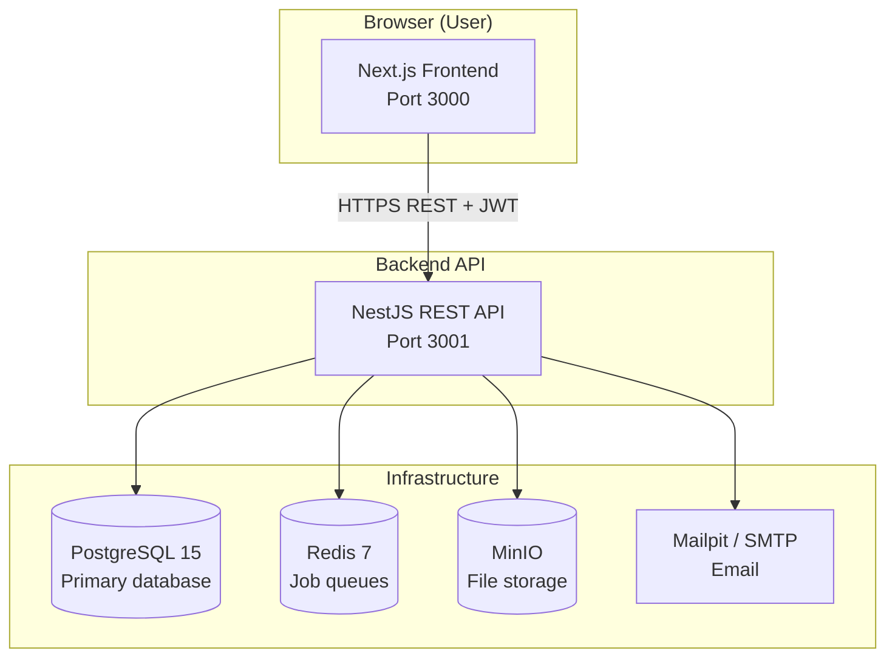

### Request lifecycle (simplified)

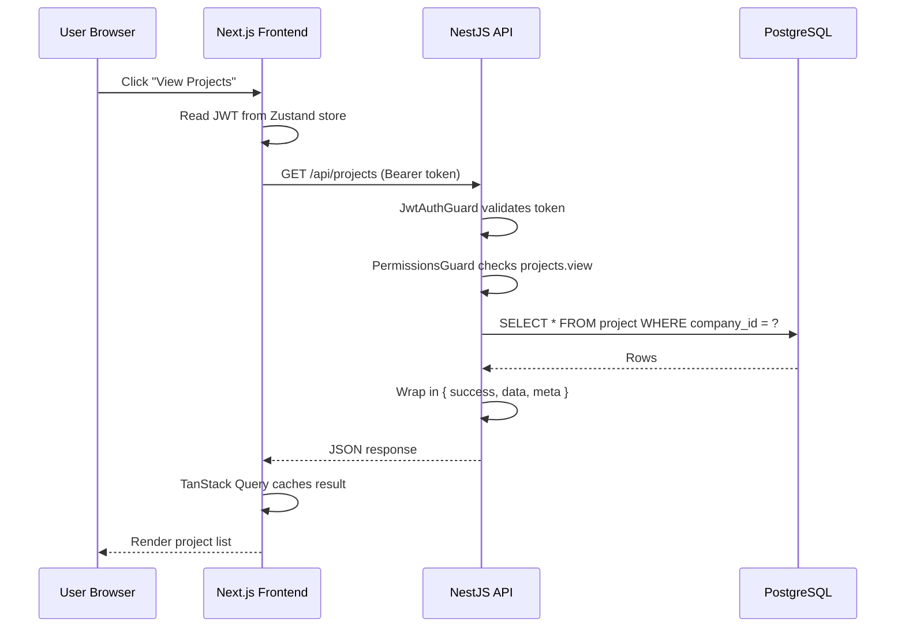

## 1.3 Major Modules

| Module | Backend path | Primary responsibility |
|--------|-------------|------------------------|
| **Auth** | `backend/src/modules/auth/` | Login, sessions, JWT, profile, password flows |
| **User Management** | `backend/src/modules/user-management/` | Users, roles, permissions, data scopes, Excel import |
| **Company Setup** | `backend/src/modules/company-setup/` | Company profile, org hierarchy, financial periods, numbering |
| **Audit** | `backend/src/modules/audit/` | Immutable audit trail for all changes |
| **Notifications** | `backend/src/modules/notifications/` | In-app + email alerts, templates, preferences |
| **Documents** | `backend/src/modules/documents/` | File storage, folders, versions, access control |
| **Reporting** | `backend/src/modules/reporting/` | Report definitions, schedules, dashboard widgets |
| **Project Management** | `backend/src/modules/project-management/` | Projects, schedule, site ops, EPC engineering workflow |

**Shared infrastructure** lives in `backend/src/shared/` - guards, interceptors, Prisma, storage, mail, permissions.

## 1.4 Module Relationships

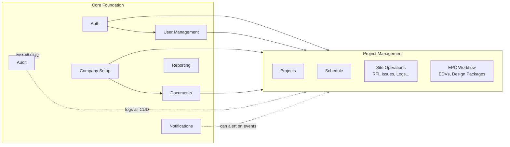

**Key dependency rules:**

1. **Every module depends on Auth** - JWT proves who you are.
2. **Every module depends on Permissions** - RBAC proves what you can do.
3. **PM depends on Documents** - engineering files live in `DocumentFolder` / `DocumentVersion`.
4. **PM depends on NumberSeries** - RFI-001, SUB-042, etc. come from PostgreSQL sequences.
5. **PM does NOT bypass company_id** - multi-tenancy is enforced everywhere.

## 1.5 Data Flow Across the System

| Layer | Technology | Responsibility |
|-------|-----------|----------------|
| **Presentation (UI)** | Next.js 16, Ant Design 6, React 19 | Pages, forms, tables, charts |
| **Client state** | Zustand | Auth tokens, UI preferences |
| **Server state** | TanStack Query v5 | API data caching, refetch, pagination |
| **HTTP** | Axios | API calls with interceptors |
| **API** | NestJS 11 REST | Validation, business logic, authorization |
| **Persistence** | Prisma ORM | Type-safe SQL to PostgreSQL |
| **Files** | MinIO (S3-compatible) | Binary document storage |
| **Async jobs** | BullMQ + Redis | Email send, workflow projection, SLA |

---

# 2. Technology Breakdown

For each technology: **what it is**, **why it's used here**, **advantages**, **disadvantages**, **alternatives**, and **industry usage**.

---

## 2.1 Languages & Runtimes

### TypeScript (strict mode)

| Aspect | Detail |
|--------|--------|
| **What** | JavaScript with static types - the compiler catches type errors before runtime |
| **Why here** | Same language on frontend and backend; shared mental model; fewer bugs in large codebases |
| **Advantages** | Autocomplete, refactoring safety, self-documenting interfaces |
| **Disadvantages** | Build step required; learning curve for beginners |
| **Alternatives** | Plain JavaScript, Python, Go, Java |
| **Industry** | Dominant in enterprise web apps (Microsoft, Google, Airbnb use TS heavily) |

**In this project:** Both `backend/tsconfig.json` and `frontend/tsconfig.json` use `strict: true`. No `any`, no `@ts-ignore` per project rules.

### Node.js 20+

| Aspect | Detail |
|--------|--------|
| **What** | JavaScript runtime outside the browser - runs your server code |
| **Why here** | NestJS and Next.js both require Node |
| **Advantages** | One language stack, huge npm ecosystem, async I/O for APIs |
| **Disadvantages** | Single-threaded; CPU-heavy work needs worker threads or queues |
| **Alternatives** | Deno, Bun, Python (Django/FastAPI), Java (Spring) |
| **Industry** | Most JavaScript backends run on Node |

---

## 2.2 Monorepo & Build Tools

### npm Workspaces + Turborepo

| Aspect | Detail |
|--------|--------|
| **What** | One `package.json` at root manages `backend` and `frontend` as workspaces; Turborepo orchestrates parallel builds |
| **Why here** | `npm run dev` starts both apps; shared scripts for DB migrate/seed |
| **Advantages** | Single clone, unified versioning, cached builds |
| **Disadvantages** | Slightly more complex than two separate repos |
| **Alternatives** | pnpm workspaces, Nx, Lerna, separate repos |
| **Industry** | Turborepo used by Vercel, many startups at scale |

**Root `package.json` scripts:**

```json
"dev": "turbo run dev",
"db:up": "docker compose up -d postgres redis minio mailpit",
"db:migrate": "npm run prisma:migrate --workspace=backend"
```

### Docker Compose

| Aspect | Detail |
|--------|--------|
| **What** | Runs PostgreSQL, Redis, MinIO, Mailpit in containers locally |
| **Why here** | Developers don't install Postgres manually; identical infra for everyone |
| **Advantages** | Reproducible, isolated, one command to start |
| **Disadvantages** | Requires Docker Desktop; port mapping quirks on Windows |
| **Alternatives** | Native installs, cloud dev databases |
| **Industry** | Standard for local development in 2020s |

**Services:** `postgres:15` (port 5433→5432), `redis:7`, `minio`, `mailpit`, `adminer`.

---

## 2.3 Backend Framework & Libraries

### NestJS 11

| Aspect | Detail |
|--------|--------|
| **What** | Node.js framework inspired by Angular - modules, dependency injection, decorators |
| **Why here** | Enterprise structure (modules, guards, pipes), TypeScript-first, Swagger built-in |
| **Advantages** | Opinionated architecture, testable, scales to large teams |
| **Disadvantages** | Boilerplate; steeper learning curve than Express |
| **Alternatives** | Express, Fastify, Hono, Spring Boot (Java) |
| **Industry** | Popular for B2B SaaS and internal enterprise APIs |

**Bootstrap** (`backend/src/main.ts`):

- Global prefix `/api`
- `helmet()` for security headers
- CORS for `http://localhost:3000`
- `ValidationPipe` with `whitelist: true` (strips unknown fields)
- Swagger at `/api/docs`

### Prisma ORM

| Aspect | Detail |
|--------|--------|
| **What** | Type-safe database client generated from `schema.prisma` |
| **Why here** | Migrations, type safety, PostgreSQL features (sequences, enums) |
| **Advantages** | Excellent DX, migration history, auto-generated types |
| **Disadvantages** | Complex queries sometimes need raw SQL; not a full DDD repository out of the box |
| **Alternatives** | TypeORM, Drizzle, Knex, raw SQL |
| **Industry** | Fast-growing choice for TypeScript backends |

**73 models, 55 enums** in `backend/prisma/schema.prisma`.

### class-validator + class-transformer

| Aspect | Detail |
|--------|--------|
| **What** | Decorators on DTO classes: `@IsEmail()`, `@IsUUID()`, `@Min(1)` |
| **Why here** | Request validation at API boundary before business logic runs |
| **Advantages** | Declarative, integrates with NestJS ValidationPipe |
| **Disadvantages** | Decorator syntax can feel magical |
| **Alternatives** | Zod, Joi (also used for env validation), Yup |
| **Industry** | Standard in NestJS ecosystems |

### @nestjs/cqrs

| Aspect | Detail |
|--------|--------|
| **What** | Command Query Responsibility Segregation - separate read and write handlers |
| **Why here** | Auth module uses `LoginCommand` → `LoginHandler` for clear write flows |
| **Advantages** | Testable handlers, single responsibility per use case |
| **Disadvantages** | More files; overkill for simple CRUD |
| **Alternatives** | Plain service methods |
| **Industry** | Common in DDD-heavy .NET/Java; growing in Node |

### Passport + JWT (@nestjs/jwt, passport-jwt)

| Aspect | Detail |
|--------|--------|
| **What** | Authentication middleware; JWT = signed JSON token proving identity |
| **Why here** | Stateless API auth; frontend stores token; no server-side sessions for every request |
| **Advantages** | Scales horizontally; works with mobile/SPA |
| **Disadvantages** | Token revocation needs extra design (this project uses `USER_SESSION`) |
| **Alternatives** | Session cookies, OAuth2 only, API keys |
| **Industry** | JWT is the default for REST APIs |

### bcrypt

| Aspect | Detail |
|--------|--------|
| **What** | Slow hashing algorithm for passwords |
| **Why here** | Passwords never stored plain; 12 rounds per `.cursorrules` |
| **Advantages** | Resistant to brute force |
| **Disadvantages** | Intentionally slow |
| **Alternatives** | argon2 (often considered stronger today) |
| **Industry** | Still widely used; argon2 gaining ground |

### BullMQ + Redis

| Aspect | Detail |
|--------|--------|
| **What** | Job queue - background work (send email, workflow SLA) off the HTTP thread |
| **Why here** | Operations >500ms should not block API responses |
| **Advantages** | Retries, scheduling, monitoring |
| **Disadvantages** | Requires Redis; more moving parts |
| **Alternatives** | RabbitMQ, SQS, in-process queues |
| **Industry** | Standard for Node async work |

**Note:** `REDIS_ENABLED=false` by default in dev - queues are optional locally.

### MinIO

| Aspect | Detail |
|--------|--------|
| **What** | S3-compatible object storage |
| **Why here** | Documents (drawings, invoices) are files, not database rows |
| **Advantages** | Same API as AWS S3; switch via `STORAGE_PROVIDER` env |
| **Disadvantages** | Another service to run |
| **Alternatives** | AWS S3, Azure Blob, local filesystem |
| **Industry** | S3 API is the de facto standard |

---

## 2.4 Frontend Framework & Libraries

### Next.js 16 (App Router)

| Aspect | Detail |
|--------|--------|
| **What** | React framework with file-based routing, server/client components |
| **Why here** | `(auth)` vs `(dashboard)` route groups, layouts, middleware |
| **Advantages** | SEO-capable, built-in routing, production optimizations |
| **Disadvantages** | Framework complexity; App Router still evolving |
| **Alternatives** | Remix, Vite + React Router, Angular |
| **Industry** | Dominant React meta-framework |

### React 19

| Aspect | Detail |
|--------|--------|
| **What** | UI library - components, hooks, virtual DOM |
| **Why here** | Ecosystem; Ant Design is React-based |
| **Advantages** | Huge community, component model |
| **Disadvantages** | Client state + server state split can confuse beginners |
| **Alternatives** | Vue, Svelte, Solid |
| **Industry** | Most popular frontend library |

### Ant Design 6

| Aspect | Detail |
|--------|--------|
| **What** | Enterprise UI component library (tables, forms, modals) |
| **Why here** | Procore-like construction ERP aesthetic; dense data UIs |
| **Advantages** | Complete design system; tables and forms out of the box |
| **Disadvantages** | Bundle size; customization learning curve |
| **Alternatives** | Material UI, Chakra, Shadcn (explicitly NOT chosen per rules) |
| **Industry** | Common in admin dashboards, especially in Asia |

### TanStack Query v5

| Aspect | Detail |
|--------|--------|
| **What** | Server state management - fetch, cache, refetch, pagination |
| **Why here** | API data should NOT live in Zustand; Query handles stale data, loading, errors |
| **Advantages** | Eliminates most `useEffect` fetch boilerplate |
| **Disadvantages** | Another abstraction to learn |
| **Alternatives** | SWR, RTK Query, plain fetch |
| **Industry** | Standard for React data fetching |

### Zustand

| Aspect | Detail |
|--------|--------|
| **What** | Lightweight client state store |
| **Why here** | Auth tokens, user profile, capabilities - data that isn't "server fetched list" |
| **Advantages** | Minimal API, persist middleware |
| **Disadvantages** | Easy to misuse for server data |
| **Alternatives** | Redux, Jotai, Context API |
| **Industry** | Popular lightweight alternative to Redux |

### Axios

| Aspect | Detail |
|--------|--------|
| **What** | HTTP client with interceptors |
| **Why here** | Attach Bearer token; retry on 401 with refresh |
| **Advantages** | Interceptors, cancellation, wide support |
| **Disadvantages** | Extra dependency vs native fetch |
| **Alternatives** | fetch, ky |
| **Industry** | Still very common in React apps |

### Tailwind CSS 4

| Aspect | Detail |
|--------|--------|
| **What** | Utility-first CSS |
| **Why here** | Layout spacing, responsive tweaks alongside Ant Design |
| **Advantages** | Fast styling without writing CSS files |
| **Disadvantages** | Verbose class strings |
| **Alternatives** | CSS Modules, styled-components |
| **Industry** | Extremely popular in modern React |

### dayjs

| Aspect | Detail |
|--------|--------|
| **What** | Date manipulation library |
| **Why here** | Ant Design peer dependency; format dates in tables |
| **Advantages** | Small, immutable API |
| **Disadvantages** | Less feature-rich than moment (intentionally) |
| **Alternatives** | date-fns, Luxon |
| **Industry** | Standard replacement for moment.js |

---

## 2.5 Testing

| Tool | Package | Purpose |
|------|---------|---------|
| **Jest** | backend | Unit tests (`*.spec.ts`), E2E (`*.e2e-spec.ts`) |
| **Supertest** | backend | HTTP integration tests against Nest app |
| **Vitest** | frontend | Component unit tests |
| **Playwright** | frontend | Browser E2E (e.g. EPC review workflow) |
| **Testing Library** | frontend | Render components, simulate user events |

**E2E specs:** `auth.e2e-spec.ts`, `rbac.e2e-spec.ts`, `audit.e2e-spec.ts`, `epc-workflow.e2e-spec.ts`.

---

## 2.6 Dependency Injection (NestJS)

**What:** The framework creates class instances and wires dependencies automatically via constructor parameters.

**Why:** Testability (mock `IAuthRepository` in tests), loose coupling, single place to configure services.

**Example** - `LoginHandler` receives repository and services without `new`:

```typescript
// backend/src/modules/auth/application/commands/login.handler.ts
constructor(
  @Inject(AUTH_REPOSITORY)
  private readonly authRepository: IAuthRepository,
  private readonly passwordService: PasswordService,
  private readonly tokenService: TokenService,
) {}
```

**Industry:** Core pattern in Spring, NestJS, Angular - "Inversion of Control."

---

# 3. Folder Structure Deep Dive

## 3.1 Repository Root

```
construction-erp/
├── backend/                 # NestJS API
├── frontend/                # Next.js UI
├── docs/                    # Architecture & domain docs
├── docker-compose.yml       # Local infrastructure
├── package.json             # Workspace root + scripts
├── turbo.json               # Build orchestration
├── .cursorrules             # AI + team coding standards
└── .env.example             # Environment template
```

| Folder | Purpose |
|--------|---------|
| `backend/` | All server code, Prisma schema, migrations |
| `frontend/` | All client code, pages, components |
| `docs/` | Human-written design docs (EPC model, PM implementation) |
| `docker-compose.yml` | Postgres, Redis, MinIO, Mailpit for local dev |

---

## 3.2 Backend Structure

```
backend/
├── prisma/
│   ├── schema.prisma        # 73 models - source of truth for DB
│   ├── migrations/          # Versioned SQL migrations (never edit old ones)
│   ├── seed.ts              # Roles, permissions, admin user
│   └── ERD.md               # Auto-generated entity diagram
├── src/
│   ├── main.ts              # Bootstrap: helmet, CORS, Swagger, ValidationPipe
│   ├── app.module.ts        # Root module - wires everything
│   ├── app.controller.ts    # Health check
│   ├── modules/             # Feature modules (bounded contexts)
│   │   ├── auth/
│   │   ├── user-management/
│   │   ├── company-setup/
│   │   ├── audit/
│   │   ├── notifications/
│   │   ├── documents/
│   │   ├── reporting/
│   │   └── project-management/
│   └── shared/              # Cross-cutting infrastructure
│       ├── guards/
│       ├── interceptors/
│       ├── filters/
│       ├── permissions/
│       ├── prisma/
│       ├── storage/
│       ├── mail/
│       ├── context/
│       ├── decorators/
│       ├── dtos/
│       └── config/
└── test/                    # E2E tests
```

### Per-module structure (intended pattern)

```
modules/{module-name}/
├── {module}.module.ts       # NestJS module registration
├── domain/                  # Pure business logic (no NestJS/Prisma)
│   ├── entities/
│   ├── value-objects/
│   ├── events/
│   └── repositories/        # Interfaces (ports)
├── application/             # Use cases
│   ├── commands/            # CQRS write handlers
│   ├── queries/             # CQRS read handlers
│   ├── dtos/                # Input/output validation classes
│   └── services/            # Orchestration services
├── infrastructure/          # Adapters
│   ├── repositories/        # Prisma implementations
│   └── mappers/
└── presentation/            # HTTP layer
    ├── controllers/
    ├── guards/
    └── pipes/
```

**Reality check:** Only `auth` and the **EPC workflow** portion of PM fully follow this. Most foundation modules use `application/services` + `presentation/controllers` calling `PrismaService` directly - a pragmatic shortcut during rapid development.

---

## 3.3 Frontend Structure

```
frontend/
├── app/                     # Next.js App Router pages
│   ├── layout.tsx           # Root: fonts, Ant Design, Query provider
│   ├── (auth)/              # Unauthenticated shell
│   │   ├── login/
│   │   ├── activate/
│   │   ├── forgot-password/
│   │   └── reset-password/
│   └── (dashboard)/         # Authenticated shell with AppShell
│       ├── page.tsx         # Home dashboard
│       ├── users/
│       ├── settings/
│       ├── profile/
│       └── projects/
│           ├── page.tsx     # Portfolio
│           └── [projectId]/ # Project workspace (20+ sub-routes)
├── components/
│   ├── ui/                  # Design system (8 core components)
│   │   ├── AppShell/
│   │   ├── DataTable/
│   │   ├── StatusBadge/
│   │   ├── KPICard/
│   │   ├── PageHeader/
│   │   ├── FormLayout/
│   │   ├── ConfirmDialog/
│   │   └── NotificationPanel/
│   └── modules/             # Feature-specific UI
│       ├── users/
│       ├── settings/
│       ├── profile/
│       └── projects/        # ~86 files for PM
├── lib/
│   ├── api/                 # Axios client + TypeScript types
│   └── query/               # TanStack Query hooks per resource
├── stores/                  # Zustand (auth, project context)
├── hooks/
├── config/                  # navConfig, theme
└── middleware.ts            # Route protection cookie gate
```

### Route groups explained

| Pattern | Meaning |
|---------|---------|
| `(auth)` | Parentheses = route group, not in URL. Shared layout for login pages. |
| `(dashboard)` | Authenticated layout with sidebar + top nav. |
| `[projectId]` | Dynamic segment - URL contains actual project UUID. |

---

# 4. Architectural Patterns

## 4.1 Layered Architecture

**Definition:** Code organized in horizontal layers; each layer only talks to the layer below.

```
Presentation → Application → Domain → Infrastructure
```

**In this codebase:** Controllers never contain business rules. Services orchestrate. Domain state machines have zero imports from NestJS.

**Benefits:** Testability, replaceable database, clear responsibilities.  
**Drawbacks:** More files, slower initial development.

---

## 4.2 Clean Architecture

**Definition:** Dependencies point inward - outer layers depend on inner abstractions, not the reverse.

**Example - Auth module:**

```
auth.controller.ts  →  LoginHandler  →  IAuthRepository (interface)
                                              ↑
                                    auth.repository.ts (Prisma)
```

The handler depends on `IAuthRepository`, not Prisma directly. You can swap PostgreSQL for another DB by changing only `infrastructure/repositories/`.

**File:** `backend/src/modules/auth/domain/repositories/auth.repository.interface.ts`

---

## 4.3 Domain-Driven Design (DDD)

**Definition:** Model software around business domains (bounded contexts), using ubiquitous language from the industry.

**Bounded contexts in this ERP:**

| Context | Language examples |
|---------|-------------------|
| Core Foundation | Company, Role, Permission, AuditLog |
| Project Management | RFI, Submittal, Punch Item, Milestone |
| EPC Engineering | EDV, Design Package, Review Session |

**Value objects & enums:** `EdvStatus`, `RfiStatus`, `ProjectTeamRole` - business states, not arbitrary strings.

---

## 4.4 Modular Monolith

**Definition:** One deployable application split into modules with clear boundaries - not microservices yet, but structured to become them later.

**In this codebase:** Each NestJS `@Module()` is a bounded context. `AppModule` imports all modules. No network calls between modules - just TypeScript imports.

**Benefits:** Simpler ops than microservices; still organized for team ownership.  
**Drawbacks:** All modules scale together; one bug can affect whole process.

---

## 4.5 CQRS (Command Query Responsibility Segregation)

**Definition:** Separate models/paths for reads (queries) and writes (commands).

**Where used:** Auth module - `LoginCommand`, `RefreshTokenCommand`, `LogoutCommand` each have dedicated handlers.

**Why not everywhere:** Simple CRUD (list RFIs, update issue) uses one service with `findMany` and `update` - CQRS would triple file count without benefit.

---

## 4.6 Repository Pattern

**Definition:** Abstract data access behind an interface; business code doesn't know about SQL.

**Full implementation:** `IAuthRepository` + `AuthRepository` (Prisma).

**Partial implementation:** EPC repositories in `backend/src/modules/project-management/infrastructure/repositories/`.

**Bypassed:** Most PM CRUD services call `this.prisma.rfi.findMany()` directly - technical debt acknowledged in project docs.

---

## 4.7 Service Layer Pattern

**Definition:** Application services coordinate use cases - validate input, call repositories, return DTOs.

**Examples:**
- `UserManagementService` - user CRUD + role assignment
- `ProjectsService` - project portfolio
- `WorkflowKernelService` - all EPC workflow mutations

---

## 4.8 Dependency Injection

**Definition:** Classes declare dependencies in constructor; framework provides instances.

**Registered in:** Each `*.module.ts` via `providers` and `exports` arrays.

---

## 4.9 Strategy Pattern

**Definition:** Swap algorithms at runtime via interface.

**Example:** `StorageService` interface with MinIO implementation; `STORAGE_PROVIDER` env switches S3/Azure/GCS without code changes (stubs route to MinIO today).

---

## 4.10 Event-Driven Architecture (Partial)

**Definition:** Components communicate via events rather than direct calls.

**Examples:**
- `WorkflowEventLog` - append-only event log for engineering workflow
- `WorkflowCommittedDispatcher` → BullMQ queue after transaction commit
- Domain events via `@nestjs/cqrs` EventBus (auth module foundation)

**Not full event sourcing:** Most entities are CRUD tables, not event-rebuilt aggregates.

---

## 4.11 State Machine Pattern

**Definition:** Entity status can only transition along defined edges.

**Files:**
- `backend/src/modules/project-management/domain/edv-state-machine.ts`
- `backend/src/modules/project-management/domain/comment-state-machine.ts`

**Why:** Prevents illegal transitions like "DRAFT → APPROVED" without review.

---

## 4.12 Interceptor / Middleware / Guard Pipeline

NestJS request pipeline:

```mermaid
flowchart LR
    REQ[HTTP Request] --> MW[RequestContextMiddleware]
    MW --> GUARD1[JwtAuthGuard]
    GUARD1 --> GUARD2[ThrottlerGuard]
    GUARD2 --> GUARD3[PermissionsGuard]
    GUARD3 --> PIPE[ValidationPipe]
    PIPE --> CTRL[Controller]
    CTRL --> SVC[Service]
    SVC --> INT1[LoggingInterceptor]
    INT1 --> INT2[ResponseEnvelopeInterceptor]
    INT2 --> INT3[AuditInterceptor]
    INT3 --> RES[HTTP Response]
```

---

# 5. Core Foundation Module Deep Dive

## 5.1 Authentication (`auth`)

### Business purpose
Prove identity, manage sessions, issue tokens, handle account lifecycle (invite, activate, reset password, change email).

### Architecture
Most complete Clean Architecture + CQRS module in the codebase.

### Login workflow

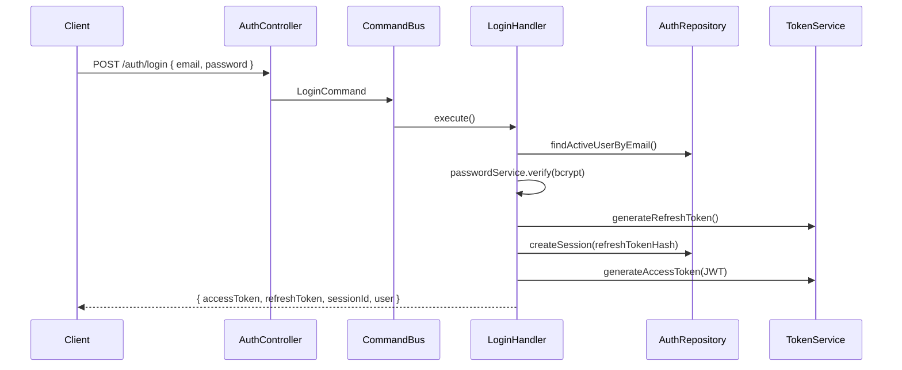

**Key implementation** - `backend/src/modules/auth/application/commands/login.handler.ts`:
1. Find user by email (must be active, not soft-deleted)
2. Verify password with bcrypt
3. Reject if email not verified
4. Create `USER_SESSION` with hashed refresh token
5. Return JWT access token (15 min) + opaque refresh token (7 days)

### Token design

| Token | Storage | Lifetime | Purpose |
|-------|---------|----------|---------|
| Access (JWT) | Client memory (Zustand) | 15 minutes | Every API call |
| Refresh (opaque) | Client + DB hash | 7 days | Get new access token |
| Session ID | Client + DB | Matches refresh | Revoke specific device |

**Why refresh rotation:** If refresh token is stolen, old hash in DB won't match after rotation.

### Session capabilities
`GET /auth/capabilities` returns UI flags (`canManageUsers`, `canViewProjects`, etc.) derived from RBAC - frontend hides nav items without exposing security (server still enforces permissions).

---

## 5.2 User Management (`user-management`)

### Business purpose
CRUD users, assign roles, bulk import from Excel, resend invitations.

### Data flow

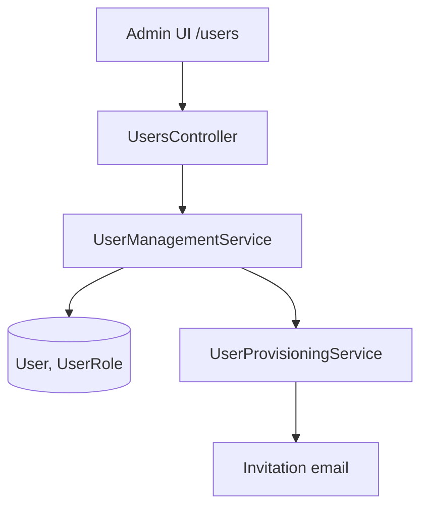

### Key features

| Feature | Endpoint | Permission |
|---------|----------|------------|
| List users | `GET /users` | `users.view` |
| Create + invite | `POST /users` | `users.create` |
| Assign role | `POST /users/:id/roles` | `users.edit` |
| Excel import | `POST /users/import` | `users.create` |
| User directory (picker) | `GET /users/directory` | `projects.view` |

**Frontend:** `frontend/components/modules/users/UsersPageContent.tsx`

---

## 5.3 Roles & Permissions (`user-management` + `shared/permissions`)

### Business purpose
RBAC - Role-Based Access Control. Users get roles; roles get permissions; permissions gate API endpoints.

### Permission model

```
Permission = module + action
Examples: projects.view, rfis.create, roles.edit

RolePermission flags per permission:
  canView, canCreate, canEdit, canDelete, canApprove, canExport
```

### Role inheritance
`Role.parentRoleId` - child roles inherit parent permissions (OR merge).

### Data scopes (row-level)
`DataScope` on `UserRole` - limit visibility to COMPANY, BRANCH, DEPARTMENT, PROJECT, or SELF.

### Permission check flow

```typescript
// backend/src/shared/permissions/permissions.guard.ts
const allowed = await this.permissionService.hasPermission(
  user.userId,
  user.companyId,
  required.module,   // e.g. 'projects'
  required.action,   // e.g. 'view'
);
```

**Frontend:** `frontend/components/modules/settings/SettingsPageContent.tsx` - permission matrix editor.

**Seed data:** `backend/prisma/seed.ts` - 12 core roles (System Administrator → Employee).

---

## 5.4 Company Setup (`company-setup`)

### Business purpose
Tenant configuration: company profile, org hierarchy, financial calendar, document numbering.

### Org hierarchy

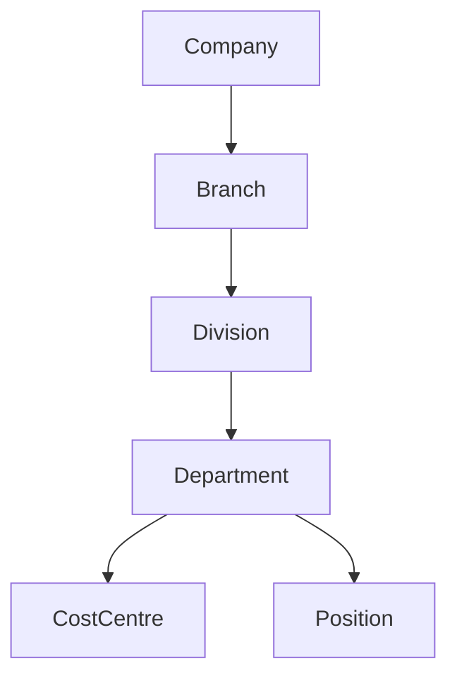

### Financial periods
Two-stage close per `.cursorrules`:
1. **LOCK** - no new transactions
2. **CLOSE** - period finalized

`FinancialYear` and `FinancialPeriod` have no soft delete - status changes only.

### Number series
`NumberSeries` stores PostgreSQL sequence **names** (not counters). `nextval()` avoids race conditions vs table-based counters.

**API:** `POST /number-series/:documentType/next`

**Frontend gap:** No dedicated UI yet - API complete, admin uses API/Swagger.

---

## 5.5 Audit Trail (`audit`)

### Business purpose
Immutable record of who changed what, when - compliance and debugging.

### How it works
Global `AuditInterceptor` on CUD operations (POST, PUT, PATCH, DELETE):
- Captures user, session, company, module, record ID
- Stores before/after JSON snapshots
- Excludes auth routes and read-only endpoints

**Table:** `AuditLog` - append-only, never updated or soft-deleted.

**Query API:** `GET /audit-logs` with filters + pagination (`audit.view` permission).

---

## 5.6 Notifications (`notifications`)

### Business purpose
Alert users to events - in-app bell + optional email.

### Architecture

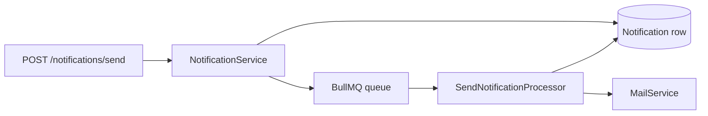

**Features:** Templates per event type, user preferences (opt out), retention cron, unread count API.

**Frontend:** `frontend/components/ui/NotificationPanel/NotificationPanel.tsx`

---

## 5.7 Document Management (`documents`)

### Business purpose
Central file storage with folders, versions, and per-role access control.

### Three concepts

| Concept | Purpose |
|---------|---------|
| `DocumentFolder` | Tree structure; `contextType` links to PROJECT, COMPANY, etc. |
| `Document` | Metadata + pointer to current version |
| `DocumentVersion` | Immutable file record; `uploadedBy` on version |

### Storage flow
1. Client requests upload
2. Backend validates type/size
3. File streamed to MinIO (`erp-documents` bucket)
4. `DocumentVersion` row created with storage key
5. Download via presigned URL (time-limited)

### Folder ACL
`DocumentAccess` - per folder, per role: view, upload, download, delete.

**PM integration:** `EngineeringDocumentFolderService` creates project-scoped folders automatically.

---

## 5.8 Reporting (`reporting`)

### Business purpose
Custom reports, scheduled exports, role-scoped dashboard widgets.

### Components
- `ReportDefinition` - JSON config for fields, filters, grouping
- `ReportSchedule` - cron + email recipients
- `DashboardWidget` - KPI tiles on home dashboard

**Frontend:** Dashboard uses widgets; `/reports` page is placeholder.

---

## 5.9 Shared Infrastructure Summary

| Component | File | Role |
|-----------|------|------|
| JWT Guard | `shared/guards/jwt-auth.guard.ts` | Global auth; `@Public()` skips |
| Permissions Guard | `shared/permissions/permissions.guard.ts` | RBAC per endpoint |
| Response envelope | `shared/interceptors/response-envelope.interceptor.ts` | `{ success, data, meta }` |
| Exception filter | `shared/filters/http-exception.filter.ts` | `{ success: false, error }` |
| Request context | `shared/context/request-context.middleware.ts` | Correlation ID for logs |
| Prisma + soft delete | `shared/prisma/soft-delete.util.ts` | `activeOnly()` helper |
| Storage | `shared/storage/` | MinIO/S3 abstraction |

**App wiring** - `backend/src/app.module.ts` registers global filter, interceptors, guards.

---

# 6. Project Management Module Deep Dive

## 6.1 Overview

**133 TypeScript files**, **19 controllers**, **~180 endpoints**, **~41 database tables**.

Two architectural styles coexist:
1. **CRUD services** - RFIs, issues, daily logs (Prisma in service)
2. **EPC workflow kernel** - engineering documents, design packages, review (domain state machines + repositories)

---

## 6.2 Projects & Portfolio

### Business purpose
Single source of truth for construction projects - code, client, dates, budget, status, team.

### Database
`Project` links to `Company`, `Branch`, `Department`, `User` (project manager).

### API
| Method | Path | Action |
|--------|------|--------|
| GET | `/projects` | Paginated portfolio list |
| POST | `/projects` | Create project |
| GET | `/projects/:id` | Detail |
| GET | `/projects/:projectId/dashboard` | KPIs |
| PUT | `/projects/:projectId/team` | Team membership |

### Frontend
- `/projects` - `PortfolioKanbanPageContent` (list/kanban)
- `/projects/[projectId]` - project dashboard
- `ProjectShell` + `ProjectWorkspaceSidebar` wrap all project pages

---

## 6.3 Schedule & Tasks

### Business purpose
Programme management - milestones, tasks, Gantt dependencies, engineering disciplines per task.

### Entities
- `Milestone` - key dates
- `Task` - hierarchical (parent/child), assignee, dates
- `TaskDiscipline` - engineering discipline scope on a task
- `TaskDependency` - FS/SS/FF/SF links for Gantt

### Frontend
`frontend/components/modules/projects/schedule/` - Gantt, calendar, milestones panel.

**API base:** `/projects/:projectId/schedule/*`

---

## 6.4 EPC Engineering Workflow (Advanced)

### Business purpose
Control engineering document lifecycle - the heart of design-build EPC contractors.

### Three-layer model

Defined in `backend/src/modules/project-management/domain/contracts/domain-boundaries.ts`:

| Layer | Entities | Responsibility |
|-------|----------|----------------|
| **Layer 1 - File** | Document, DocumentVersion, DocumentFolder | Storage only |
| **Layer 2 - Engineering** | EngineeringDocument, EngineeringDocumentVersion, DesignPackage | EDV status is **sole lifecycle authority** |
| **Layer 3 - Workflow** | ReviewSession, ReviewComment, WorkflowEventLog | Review orchestration; projected statuses are derived |

### State classes

1. **Source of truth:** `EngineeringDocumentVersion.status` - only writable via `WorkflowKernel`
2. **Structural aggregates:** `DesignPackage.projectedStatus`, `TaskDiscipline.projectedStatus` - computed in Phase B
3. **Ephemeral:** `ReviewSession`, `ReviewComment` - session-scoped, not authoritative for EDV

### WorkflowKernel

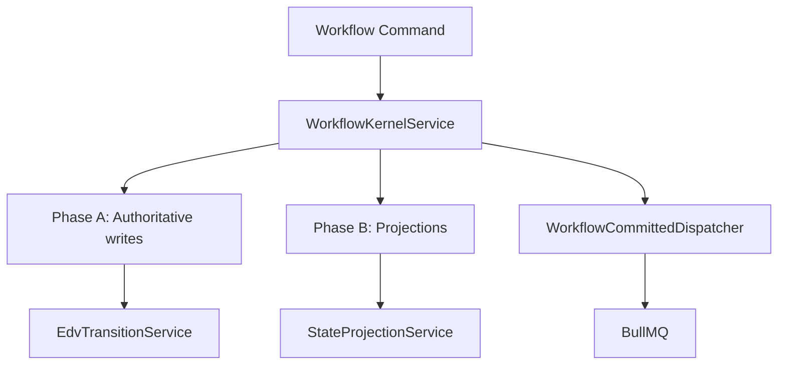

**Guards:** `ConflictGuardService`, `DefinitionOfDoneService`, `PermissionResolverService`, `StatusWriteGateService`

### Key screens
- `/projects/[projectId]/disciplines` - discipline list
- `/projects/[projectId]/disciplines/[taskDisciplineId]` - workspace
- `/projects/[projectId]/engineering-documents/[edId]` - EDV detail
- `/projects/[projectId]/review-inbox` - pending reviews
- `/projects/[projectId]/overview/status` - status board

---

## 6.5 Submittals

### Business purpose
Formal submission of shop drawings, product data, samples for client/consultant approval.

### Types
- Design package submittals
- Construction submittals
- External release workflow

### Workflow actions
`submit-to-lead`, `issue`, `batch-issue`, review sessions.

**Frontend:** `frontend/components/modules/projects/submittals/`

---

## 6.6 RFIs (Requests for Information)

### Business purpose
Formal questions from site to designer/client - tracked, numbered, with responses.

### Model
- `Rfi` - subject, priority, status, assignee
- `RfiResponse` - threaded responses

### Numbering
`DocumentNumberService` → `NumberSeries` type `RFI`.

**Status workflow:** Defined in `frontend/lib/api/workflow.ts` as `RFI_WORKFLOW`.

---

## 6.7 Site Operations

| Feature | Tables | Frontend route |
|---------|--------|----------------|
| **Daily logs** | DailyLog + workforce/equipment/visitors/incidents | `/daily-logs` |
| **Meetings** | Meeting + agenda, attendees, action items | `/meetings` |
| **Correspondence** | Correspondence | `/correspondence` |
| **Risks** | Risk | `/risks` |
| **Issues** | Issue | `/issues` |
| **Punch list** | PunchItem | `/punch-list` |
| **Drawings** | Drawing + versions + links | `/drawings` |

Each follows: **Controller → Service → Prisma**, with `PmContext { companyId, userId }` on every call.

---

## 6.8 Closeout

### Business purpose
Project handover - checklist, warranties, final account preparation.

### Model
- `Closeout` - overall closeout record and status
- `CloseoutChecklistItem` - individual handover tasks
- `Warranty` - warranty periods and documents

### API
`GET/POST/PATCH /projects/:projectId/closeout`  
`PATCH /checklist/:itemId`  
`POST /warranties`

**Frontend:** `frontend/components/modules/projects/closeout/CloseoutPageContent.tsx`

---

## 6.9 Project Team Permissions

Beyond global RBAC, EPC uses **project-team roles**:

`ProjectTeam` + `ProjectTeamRole` enum (designer, reviewer, discipline lead, chief engineer, etc.)

`PermissionResolverService` evaluates whether a user can approve, comment, or transition EDVs **within a specific project**.

**Frontend:** `RoleLensProvider` filters navigation and actions by project role.

---

## 6.10 PM ↔ Foundation Integration

| Integration | How |
|-------------|-----|
| Auth | JWT on every request; `companyId` from token |
| RBAC | `@RequirePermission('rfis', 'create')` etc. |
| Documents | `EngineeringDocumentFolderService` → `DocumentFolder` |
| Numbering | `DocumentNumberService` → `NumberSeries` + `nextval()` |
| Org structure | `Project.branchId`, `departmentId` |
| Users | `ProjectTeam.userId`, assignees on tasks/RFIs |
| Async | BullMQ when `REDIS_ENABLED=true` |

---

# 7. Database Design Analysis

## 7.1 Design Principles (from `.cursorrules`)

Every user-facing table has:
- `id` (UUID)
- `company_id` (tenant isolation)
- `created_at`, `created_by`, `updated_at`, `updated_by`
- `deleted_at`, `deleted_by` (soft delete)

**Exceptions (immutable / no soft delete):** `AuditLog`, `DocumentVersion`, `FinancialYear`, `FinancialPeriod`, `WorkflowEventLog`

---

## 7.2 Core Foundation ER Diagram

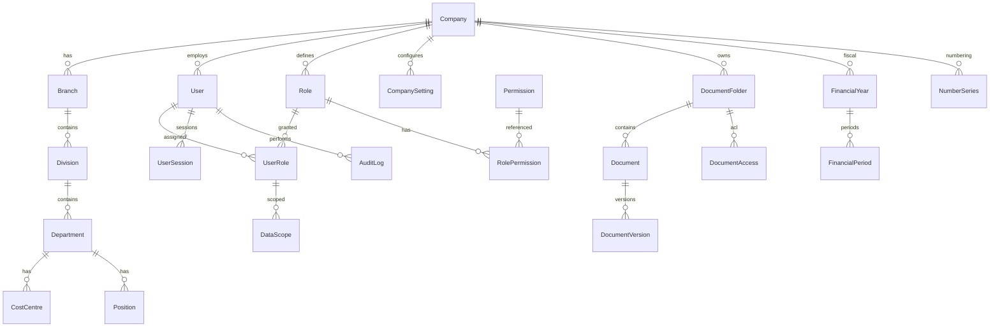

---

## 7.3 Project Management ER Diagram (simplified)

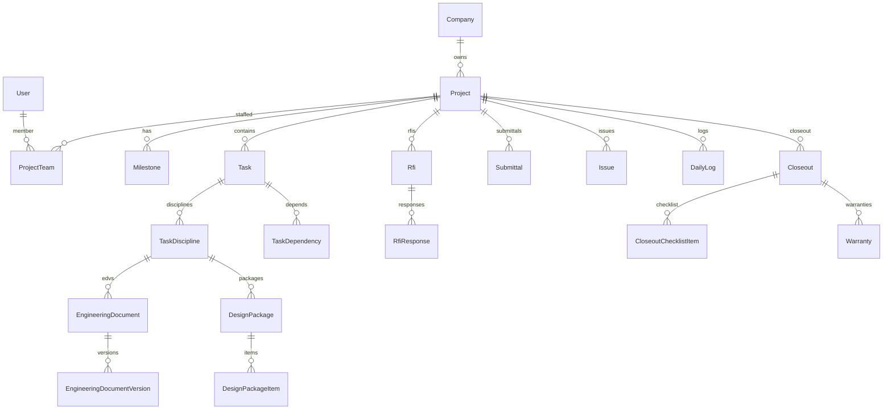

---

## 7.4 Key Tables Explained

### `User`
| Aspect | Detail |
|--------|--------|
| **Purpose** | System login identity |
| **FKs** | `companyId` → Company |
| **Security** | `passwordHash` never exposed in API responses |
| **Lifecycle** | Invited → activated → active → soft-deleted |

### `Role` + `Permission` + `RolePermission`
| Aspect | Detail |
|--------|--------|
| **Purpose** | RBAC matrix |
| **FKs** | Role belongs to Company; Permission is global catalog |
| **Constraint** | Unique role name per company |
| **Inheritance** | `parentRoleId` self-reference |

### `Project`
| Aspect | Detail |
|--------|--------|
| **Purpose** | Construction job container |
| **FKs** | companyId, branchId, departmentId, projectManagerId |
| **Indexes** | company_id + deleted_at (every list query) |
| **Status** | `ProjectStatus` enum - PLANNING, ACTIVE, ON_HOLD, COMPLETED, CANCELLED |

### `EngineeringDocumentVersion`
| Aspect | Detail |
|--------|--------|
| **Purpose** | Authoritative engineering document lifecycle |
| **Critical field** | `status` (EdvStatus enum) - only WorkflowKernel writes |
| **Relationship** | Belongs to EngineeringDocument → TaskDiscipline → Task → Project |

### `WorkflowEventLog`
| Aspect | Detail |
|--------|--------|
| **Purpose** | Append-only audit of workflow actions |
| **Immutable** | Corrections via `WorkflowCorrectionService`, not updates |
| **Why** | Traceability for disputes and regulatory review |

---

## 7.5 Indexes Strategy

Per `.cursorrules`, indexes on:
- `company_id` (every query filters tenant)
- `company_id + deleted_at` (active records)
- All foreign keys
- Columns in WHERE and ORDER BY

---

## 7.6 Multi-Tenancy

**Rule:** Every query MUST include `company_id`. Never trust `company_id` from request body - always from JWT.

```typescript
// Typical service pattern
await this.prisma.project.findMany({
  where: {
    companyId: ctx.companyId,
    ...activeOnly(),
  },
});
```

---

# 8. API Architecture

## 8.1 API Contract

### Success response
```json
{
  "success": true,
  "data": { ... },
  "meta": { "total": 100, "page": 1, "limit": 20, "pages": 5 }
}
```

Wrapped by `ResponseEnvelopeInterceptor` - `backend/src/shared/interceptors/response-envelope.interceptor.ts`

### Error response
```json
{
  "success": false,
  "error": {
    "code": "FORBIDDEN",
    "message": "Missing permission: projects.view"
  }
}
```

From `HttpExceptionFilter`.

---

## 8.2 Request Flow (Detailed)

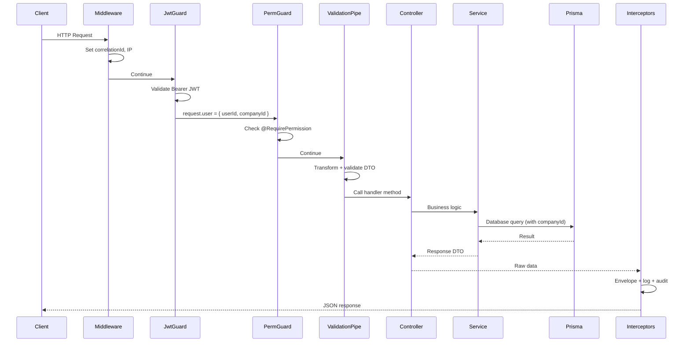

---

## 8.3 Validation

DTO example pattern:
```typescript
export class CreateProjectDto {
  @IsString()
  @MaxLength(100)
  name: string;

  @IsEnum(ProjectType)
  type: ProjectType;

  @IsOptional()
  @IsUUID()
  branchId?: string;
}
```

`ValidationPipe` options in `main.ts`:
- `whitelist: true` - strip unknown properties (prevents mass assignment)
- `forbidNonWhitelisted: true` - reject unknown properties
- `transform: true` - convert query strings to numbers/booleans

---

## 8.4 Pagination

Query params: `?page=1&limit=20&sortBy=createdAt&sortOrder=desc`

Services return `{ data: T[], meta: PaginationMeta }` - interceptor wraps into envelope.

**DTO:** `backend/src/shared/dtos/pagination-query.dto.ts`

---

## 8.5 API Endpoint Catalog (Summary)

### Core Foundation (~120 endpoints)

| Area | Base path | Count |
|------|-----------|-------|
| Auth | `/auth` | 12 |
| Users | `/users` | 9 + import |
| Roles | `/roles`, `/permissions`, `/data-scopes` | 11 |
| Company | `/company`, `/company-settings` | 6 |
| Org | `/branches`, `/divisions`, `/departments`, etc. | 20 |
| Financial | `/financial-years`, `/financial-periods`, `/number-series` | 10 |
| Audit | `/audit-logs` | 1 |
| Notifications | `/notifications`, `/notification-templates` | 10 |
| Documents | `/document-folders`, `/documents` | 15 |
| Reporting | `/reports`, `/dashboard` | 12 |

### Project Management (~180 endpoints)

| Controller | Base path |
|------------|-----------|
| ProjectsController | `/projects` |
| ScheduleController | `/projects/:projectId/schedule` |
| RfisController | `/projects/:projectId/rfis` |
| SubmittalsController | `/projects/:projectId/submittals` |
| EngineeringDocumentsController | `.../engineering-documents` |
| DesignPackagesController | `.../design-packages` |
| EpcWorkspaceController | `/review-inbox`, `/status-board`, etc. |
| DailyLogsController | `.../daily-logs` |
| MeetingsController | `.../meetings` |
| CloseoutController | `.../closeout` |
| (+ 9 more) | issues, risks, punch, drawings, correspondence |

**Full interactive docs:** `http://localhost:3001/api/docs` (Swagger)

---

## 8.6 Error Handling

| Exception | HTTP | When |
|-----------|------|------|
| `BadRequestException` | 400 | Invalid input |
| `UnauthorizedException` | 401 | Bad credentials / expired token |
| `ForbiddenException` | 403 | Missing permission |
| `NotFoundException` | 404 | Entity not found (or wrong tenant) |
| `ConflictException` | 409 | Duplicate unique field |

Never expose stack traces in production.

---

# 9. Frontend Architecture

## 9.1 Component Hierarchy

```
app/layout.tsx
  └── AntDesignProvider (theme)
      └── QueryProvider (TanStack Query)
          └── (dashboard)/layout.tsx
              └── AppShell
                  ├── TopNav (navy #1B2B4B)
                  ├── Sidebar (dark #2C3E50)
                  ├── NotificationPanel
                  └── {children} ← page content
```

## 9.2 The 8 Core UI Components

Built first per `.cursorrules` - every module page assembles from these:

| # | Component | Purpose |
|---|-----------|---------|
| 1 | AppShell | Layout chrome |
| 2 | DataTable | Search, sort, filter, pagination |
| 3 | StatusBadge | Colored status pills |
| 4 | KPICard | Metric + trend |
| 5 | PageHeader | Breadcrumb + title + actions |
| 6 | FormLayout | Consistent form spacing |
| 7 | ConfirmDialog | Delete/approve confirmations |
| 8 | NotificationPanel | Bell dropdown |

**Example:** `frontend/components/ui/StatusBadge/StatusBadge.tsx`

---

## 9.3 Routing & Auth

### Middleware (`frontend/middleware.ts`)
- Checks cookie `erp-authenticated` (lightweight flag)
- Redirects unauthenticated users to `/login`
- JWT stored in Zustand (not cookie) - middleware is first gate only

### Auth store (`frontend/stores/auth.store.ts`)
Persists: `accessToken`, `refreshToken`, `sessionId`, `user`, `capabilities`

### Silent refresh (`frontend/lib/api/client.ts`)
On 401:
1. Call `POST /auth/refresh` with sessionId + refreshToken
2. Update Zustand
3. Retry original request
4. On failure → clear auth → redirect login

---

## 9.4 Data Fetching Pattern

```typescript
// Typical hook in frontend/lib/query/projects.ts
export function useProjects(params: ProjectListParams) {
  return useQuery({
    queryKey: ['projects', params],
    queryFn: () => apiGetPaginated<Project>('/projects', { params }),
  });
}
```

**Rules:**
- Server state → TanStack Query
- Client state (auth, UI) → Zustand
- Form state → Ant Design Form

---

## 9.5 Project Workspace Navigation

`frontend/lib/navigation/project-workspace-nav.ts` defines sidebar groups:

| Group | Routes |
|-------|--------|
| Overview | Dashboard, status board, workload |
| Engineering | Disciplines, deliverables, drawings |
| Review & Release | Review inbox, submittals, external release |
| Site Operations | RFIs, issues, daily logs, punch list |
| Records | Meetings, correspondence, risks, closeout |

`RoleLensProvider` hides items user cannot access.

---

## 9.6 Screen Catalog

### Core Foundation screens

| Screen | Route | Backend APIs |
|--------|-------|--------------|
| Login | `/login` | POST `/auth/login` |
| Users | `/users` | `/users/*` |
| Roles/Settings | `/settings` | `/roles/*`, `/permissions` |
| Profile | `/profile` | `/auth/me`, change-password |
| Dashboard | `/` | `/dashboard/widgets`, stats |
| Notifications | Bell panel | `/notifications/*` |

### Project Management screens (per project)

| Screen | Route | Key APIs |
|--------|-------|----------|
| Portfolio | `/projects` | GET `/projects` |
| Dashboard | `/projects/[id]` | GET `.../dashboard` |
| Schedule | `.../schedule` | `/schedule/tasks`, milestones |
| RFIs | `.../rfis` | `/rfis` |
| Submittals | `.../submittals` | `/submittals` |
| Review inbox | `.../review-inbox` | `/review-inbox` |
| Closeout | `.../closeout` | `/closeout` |

---

## 9.7 Forms & Validation

Ant Design `Form` with rules mirroring backend DTOs:
```typescript
<Form.Item
  name="name"
  rules={[{ required: true, message: 'Project name is required' }]}
>
  <Input />
</Form.Item>
```

Client validation improves UX; **server always re-validates** - never trust frontend alone.

---

# 10. Security Architecture

## 10.1 Authentication

| Mechanism | Implementation |
|-----------|----------------|
| Password storage | bcrypt, 12 rounds |
| Access token | JWT, 15 min, signed with `JWT_ACCESS_SECRET` |
| Refresh token | Opaque 64-byte hex, bcrypt hash in `USER_SESSION` |
| Session per device | `USER_SESSION` row with deviceInfo, IP |
| Account activation | Email link → `POST /auth/activate-account` |
| Rate limiting | 10 req/min on auth endpoints (`@Throttle`) |

## 10.2 Authorization

| Layer | Mechanism |
|-------|-----------|
| API | `@RequirePermission(module, action)` + `PermissionsGuard` |
| UI | Capabilities + hidden nav (defense in depth, not sole security) |
| Documents | Additional `DocumentPermissionService` folder ACL |
| EPC | `PermissionResolverService` project-team roles |
| Data scopes | `DataScope` row-level (API ready) |

## 10.3 Multi-Tenancy Security

- `companyId` from JWT only
- All Prisma queries filter `companyId`
- Returning 404 (not 403) for cross-tenant ID guesses prevents information leakage

## 10.4 Input Validation

- `ValidationPipe` strips unknown fields
- `class-validator` on all DTOs
- File uploads: type and size checked before MinIO
- UUID params validated with `@IsEntityUuid()` decorator

## 10.5 SQL Injection

**Protected by Prisma** - parameterized queries only. Raw SQL (if any) must be documented and parameterized.

## 10.6 XSS (Cross-Site Scripting)

- React escapes output by default
- Never render raw HTML from user input
- Ant Design components handle escaping

## 10.7 CSRF

- JWT in `Authorization` header (not cookie) for API - immune to classic CSRF on API
- Frontend auth cookie is flag only, not the actual token

## 10.8 HTTP Security Headers

`helmet()` in `main.ts` - X-Content-Type-Options, X-Frame-Options, etc.

## 10.9 CORS

Restricted to `CORS_ORIGIN` (default `http://localhost:3000`).

## 10.10 Audit & Compliance

Every CUD operation logged to immutable `AuditLog` with user, timestamp, before/after state.

---

# 11. Software Engineering Concepts

## 11.1 SOLID Principles

| Principle | Meaning | In this project |
|-----------|---------|-----------------|
| **S** - Single Responsibility | One class, one reason to change | `LoginHandler` only handles login; `TokenService` only tokens |
| **O** - Open/Closed | Open for extension, closed for modification | New workflow commands extend `WorkflowKernel` without changing EDV machine |
| **L** - Liskov Substitution | Subtypes replaceable for base types | `IAuthRepository` implementations interchangeable in tests |
| **I** - Interface Segregation | Small focused interfaces | `IStorageService` - upload/download/delete only |
| **D** - Dependency Inversion | Depend on abstractions | Handlers depend on `IAuthRepository`, not Prisma |

## 11.2 DRY (Don't Repeat Yourself)

- Shared `PaginationQueryDto`, `activeOnly()`, `PmContext` type
- Reusable UI components (DataTable, StatusBadge)
- Central `apiClient` instead of fetch per page

## 11.3 KISS (Keep It Simple, Stupid)

- PM CRUD uses direct Prisma in services - simpler than full CQRS for list endpoints
- Middleware cookie flag instead of parsing JWT in Edge middleware

## 11.4 Separation of Concerns

- Controllers: HTTP only
- Services: business orchestration
- Domain: pure logic (state machines)
- Prisma: data access

## 11.5 Encapsulation

- `passwordHash` never in response DTOs
- Refresh tokens stored hashed - even DB leak doesn't expose usable tokens

## 11.6 Cohesion & Coupling

- **High cohesion:** `CloseoutService` only handles closeout
- **Low coupling:** Modules communicate via shared tables and injected services, not circular imports

## 11.7 Composition over Inheritance

- React components compose `PageHeader` + `DataTable` + `StatusBadge`
- NestJS modules compose via `imports` array, not class inheritance

---

# 12. Why The Original Developer Built It This Way

## 12.1 Monorepo (not separate repos)

**Why:** One team, shared types potential, unified `db:migrate` scripts.  
**Tradeoff:** Larger clone; can't deploy frontend/backend on fully independent cadences without discipline.  
**Enterprise fit:** Standard for product companies before microservices split.

## 12.2 NestJS (not Express)

**Why:** Enforces module boundaries, DI, guards, pipes - scales to 50+ developers.  
**Tradeoff:** Boilerplate for hello-world; worth it at ERP scale.  
**Alternative rejected:** Raw Express - too little structure for 73 tables.

## 12.3 PostgreSQL (not MongoDB)

**Why:** Construction ERP is relational - projects have tasks have disciplines have documents. ACID transactions for financial-adjacent data.  
**Tradeoff:** Schema migrations required for changes.  
**Sequences:** `NumberSeries` uses PostgreSQL `nextval()` - correct choice for concurrent document numbering.

## 12.4 Prisma (not TypeORM)

**Why:** Best-in-class TypeScript DX, migration workflow, schema as documentation.  
**Tradeoff:** Repository pattern not automatic - team uses Prisma directly in many services.  
**Path forward:** Extract repositories incrementally for PM CRUD.

## 12.5 JWT + Refresh Sessions (not server sessions only)

**Why:** Stateless API scaling; mobile/portal ready.  
**Tradeoff:** Revocation complexity - solved with `USER_SESSION` table.  
**Security:** Refresh token rotation prevents long-lived stolen access tokens.

## 12.6 RBAC + Capabilities (not per-module roles)

**Why:** `.cursorrules` defines 12 business roles, not 40 module-specific roles. One person can hold multiple roles.  
**Tradeoff:** Permission matrix complexity - mitigated by seed data and settings UI.

## 12.7 Soft Delete (not hard delete)

**Why:** Construction disputes need history; accidental deletes recoverable.  
**Tradeoff:** Every query needs `deleted_at IS NULL` - enforced via `activeOnly()` helper and Prisma middleware goal.

## 12.8 API Envelope (not raw arrays)

**Why:** Consistent error handling; pagination meta; GraphQL migration path.  
**Tradeoff:** Slight payload overhead; frontend must unwrap.

## 12.9 EPC Three-Layer Model

**Why:** File storage, engineering metadata, and review workflow have different lifecycles - collapsing them causes bugs (e.g., deleting file shouldn't delete review history).  
**Tradeoff:** Steep learning curve; ~40 domain files.  
**Payoff:** Enterprise-grade document control comparable to commercial EDMS tools.

## 12.10 Ant Design (not Shadcn)

**Why:** Dense data tables, enterprise forms, Procore-like aesthetic out of the box.  
**Tradeoff:** Heavier bundle; less trendy minimal look.

## 12.11 TanStack Query + Zustand split

**Why:** Industry best practice - don't put API cache in global client store.  
**Tradeoff:** Two state libraries to learn.

## 12.12 BullMQ optional in dev

**Why:** `REDIS_ENABLED=false` lets developers run without Redis for basic CRUD.  
**Tradeoff:** Workflow async features differ between dev and prod - E2E tests force `REDIS_ENABLED=false`.

---

# 13. Step-by-Step Recreation Guide

## Phase 0 - Prerequisites (1–2 weeks)

**Goal:** Understand fundamentals.

| Learn | Resource focus |
|-------|----------------|
| HTML/CSS/JS basics | MDN Web Docs |
| TypeScript | Official TS handbook |
| SQL fundamentals | PostgreSQL tutorial |
| HTTP/REST | Mozilla HTTP guide |
| Git | Basic commit, branch, merge |

---

## Phase 1 - Empty Monorepo (Day 1–2)

**Goal:** Runnable empty shell.

**Create:**
```
construction-erp/
├── package.json          # workspaces: backend, frontend
├── turbo.json
├── docker-compose.yml    # postgres only initially
├── backend/              # nest new
└── frontend/             # create-next-app
```

**Commands:**
```bash
npm install
docker compose up -d postgres
cd backend && npx prisma init
```

**Concepts:** Monorepo, Docker, environment variables.

---

## Phase 2 - Database Foundation (Week 1)

**Goal:** Company + User tables with migrations.

**Files:**
- `backend/prisma/schema.prisma` - Company, User models
- `backend/prisma/migrations/` - first migration
- `backend/prisma/seed.ts` - admin user

**Concepts:** Migrations, UUID keys, timestamps, soft delete columns, `company_id` on every table.

**Order:** Company → User (User depends on Company).

---

## Phase 3 - NestJS Core (Week 2)

**Goal:** Health check + Prisma + config validation.

**Files:**
- `backend/src/main.ts`
- `backend/src/app.module.ts`
- `backend/src/shared/prisma/prisma.module.ts`
- `backend/src/shared/config/env.validation.ts` (Joi)
- `backend/src/shared/filters/http-exception.filter.ts`
- `backend/src/shared/interceptors/response-envelope.interceptor.ts`

**Concepts:** Dependency injection, modules, global pipes/filters/interceptors.

---

## Phase 4 - Authentication (Week 3)

**Goal:** Login, JWT, refresh, sessions.

**Files:**
- `auth.module.ts`
- `domain/repositories/auth.repository.interface.ts`
- `infrastructure/repositories/auth.repository.ts`
- `application/commands/login.{command,handler}.ts`
- `application/services/token.service.ts`, `password.service.ts`
- `presentation/controllers/auth.controller.ts`
- `presentation/strategies/jwt.strategy.ts`
- `shared/guards/jwt-auth.guard.ts`

**Concepts:** bcrypt, JWT, refresh rotation, CQRS, repository pattern.

**Test:** `auth.e2e-spec.ts` - login returns tokens.

---

## Phase 5 - RBAC (Week 4)

**Goal:** Roles, permissions, guards.

**Files:**
- Prisma: Role, Permission, RolePermission, UserRole
- `shared/permissions/permission.service.ts`
- `shared/permissions/permissions.guard.ts`
- `user-management/` module
- `seed.ts` - 12 roles + permission matrix

**Concepts:** Authorization vs authentication, decorator metadata (`@RequirePermission`).

---

## Phase 6 - Frontend Auth Shell (Week 5)

**Goal:** Login page, protected dashboard, token refresh.

**Files:**
- `frontend/middleware.ts`
- `frontend/stores/auth.store.ts`
- `frontend/lib/api/client.ts`
- `frontend/app/(auth)/login/page.tsx`
- `frontend/app/(dashboard)/layout.tsx`
- `frontend/components/ui/AppShell/`

**Concepts:** Next.js App Router, route groups, Axios interceptors, Zustand persist.

---

## Phase 7 - Core Foundation APIs (Weeks 6–8)

**Goal:** Company setup, audit, notifications, documents.

**Order:**
1. Company setup (org hierarchy)
2. Audit interceptor
3. Document folders + MinIO storage
4. Notifications (in-app first, email queue later)
5. Reporting/dashboard widgets

**Concepts:** File storage abstraction, interceptors, BullMQ queues, immutable tables.

---

## Phase 8 - Project CRUD (Weeks 9–10)

**Goal:** Project portfolio + team.

**Files:**
- Prisma: Project, ProjectTeam
- `project-management.module.ts`
- `projects.controller.ts`, `projects.service.ts`
- `frontend/app/(dashboard)/projects/`
- `frontend/lib/query/projects.ts`

**Concepts:** Nested routes, pagination, multi-tenancy in every query.

---

## Phase 9 - Schedule & Site Ops (Weeks 11–14)

**Goal:** Tasks, RFIs, issues, daily logs, meetings, etc.

**Order:** Milestone/Task → RFI → Issues → Daily logs → Meetings → Risks → Punch → Closeout

**Per feature:**
1. Prisma models + migration
2. DTOs in `pm.dtos.ts`
3. Service + controller
4. TanStack Query hook
5. Page content component

**Concepts:** Nested resources, document numbering via NumberSeries.

---

## Phase 10 - EPC Workflow (Weeks 15–20+)

**Goal:** Engineering document control.

**Order:**
1. Domain boundaries contract
2. EDV state machine (unit tests first)
3. Infrastructure repositories
4. WorkflowKernel + Phase A/B projection
5. Review inbox UI
6. BullMQ committed processor
7. E2E Playwright test

**Concepts:** State machines, event log, command pattern, derived state.

---

## Phase 11 - Production Hardening

- Rate limiting in production
- HTTPS ingress
- Structured JSON logging
- Test coverage ≥80% on services
- CI pipeline (lint, test, build)

---

# 14. Learning Path

## Beginner (Months 1–2)

| Topic | Why it matters | In this project | Study next |
|-------|----------------|-----------------|------------|
| HTML/CSS | Web structure | Login page layout | Flexbox, Grid |
| JavaScript | Language base | Everywhere | TypeScript |
| Git | Version control | Whole repo | Branching strategies |
| SQL | Data storage | All 73 tables | JOINs, indexes |
| HTTP/REST | Client-server | Every API call | Status codes, headers |

## Intermediate (Months 3–4)

| Topic | Why it matters | In this project | Study next |
|-------|----------------|-----------------|------------|
| TypeScript | Type safety | Strict mode both packages | Generics, utility types |
| React | UI components | All frontend pages | Hooks, composition |
| Node.js + Express concepts | Server runtime | Under NestJS hood | Event loop, async |
| PostgreSQL | Relational DB | Prisma target | Transactions, sequences |
| REST API design | Integration | `/api/*` endpoints | OpenAPI/Swagger |

## Upper Intermediate (Months 5–6)

| Topic | Why it matters | In this project | Study next |
|-------|----------------|-----------------|------------|
| NestJS | Enterprise backend | All backend modules | Guards, pipes, modules |
| Prisma | ORM | schema.prisma | Migrations, relations |
| Next.js App Router | Modern React routing | `app/` directory | Server vs client components |
| TanStack Query | Server state | `lib/query/*` | Cache invalidation |
| JWT auth | API security | auth module | Refresh rotation |
| Docker | Local infra | docker-compose.yml | Kubernetes basics |

## Advanced (Months 7–12)

| Topic | Why it matters | In this project | Study next |
|-------|----------------|-----------------|------------|
| Clean Architecture | Maintainability | auth + EPC domain | Hexagonal architecture |
| DDD | Complex domains | EPC workflow | Bounded contexts |
| CQRS | Write/read split | Auth commands | Event sourcing |
| RBAC | Enterprise authz | Permission system | ABAC, policy engines |
| State machines | Workflow correctness | edv-state-machine | Temporal, XState |
| BullMQ | Async processing | Notifications, workflow | Redis internals |
| Multi-tenancy | SaaS security | company_id everywhere | Row-level security |
| E2E testing | Confidence | Playwright, Supertest | CI/CD pipelines |

## Expert (Year 2+)

| Topic | Why it matters | In this project | Study next |
|-------|----------------|-----------------|------------|
| Event-driven architecture | Scale & decoupling | WorkflowEventLog | Kafka, outbox pattern |
| S3/object storage | Document systems | MinIO integration | CDN, presigned URLs |
| Performance at scale | 200 concurrent users | Pagination, indexes | Caching, read replicas |
| Kubernetes deployment | Production ops | Planned per .cursorrules | Helm, observability |
| Domain modeling (construction) | Correct features | RFI, submittal, closeout | PMI, ISO 19650 |

---

# Appendix A - Key File Reference

| Purpose | Path |
|---------|------|
| Root scripts | `package.json` |
| Backend bootstrap | `backend/src/main.ts` |
| Module wiring | `backend/src/app.module.ts` |
| DB schema | `backend/prisma/schema.prisma` |
| Seed data | `backend/prisma/seed.ts` |
| Coding standards | `.cursorrules` |
| Login handler | `backend/src/modules/auth/application/commands/login.handler.ts` |
| Permission guard | `backend/src/shared/permissions/permissions.guard.ts` |
| API envelope | `backend/src/shared/interceptors/response-envelope.interceptor.ts` |
| EPC domain boundaries | `backend/src/modules/project-management/domain/contracts/domain-boundaries.ts` |
| Axios client | `frontend/lib/api/client.ts` |
| Auth store | `frontend/stores/auth.store.ts` |
| Route middleware | `frontend/middleware.ts` |
| PM types | `frontend/lib/api/project-management.types.ts` |
| EPC design docs | `docs/epc-operating-model.md` |

---

# Appendix B - Glossary (Construction + Software)

| Term | Meaning |
|------|---------|
| **ERP** | Enterprise Resource Planning - integrated business software |
| **RFI** | Request for Information - formal question during construction |
| **Submittal** | Documents submitted for approval (shop drawings, samples) |
| **EDV** | Engineering Document Version - controlled engineering file revision |
| **EPC** | Engineering, Procurement, Construction - project delivery model |
| **Punch list** | Snag list of defects before handover |
| **Closeout** | Final project handover phase |
| **RBAC** | Role-Based Access Control |
| **JWT** | JSON Web Token - signed credential |
| **DTO** | Data Transfer Object - validated API input/output shape |
| **ORM** | Object-Relational Mapping - Prisma |
| **CQRS** | Command Query Responsibility Segregation |
| **Tenant** | One company's isolated data in multi-tenant SaaS |

---

# Appendix C - Running the System Locally

```bash
# 1. Start infrastructure
npm run db:up

# 2. Migrate and seed
npm run db:migrate
npm run db:seed

# 3. Start both apps
npm run dev

# 4. Open
# Frontend: http://localhost:3000
# API docs: http://localhost:3001/api/docs
# Mailpit:  http://localhost:8025
# MinIO:    http://localhost:9001
```

**Default admin:** See `SEED_ADMIN_EMAIL` / `SEED_ADMIN_PASSWORD` in `.env.example`.

---

*This guide was generated from analysis of the live codebase. As the project evolves, compare against `backend/prisma/schema.prisma`, Swagger at `/api/docs`, and `docs/` for the latest domain decisions.*
