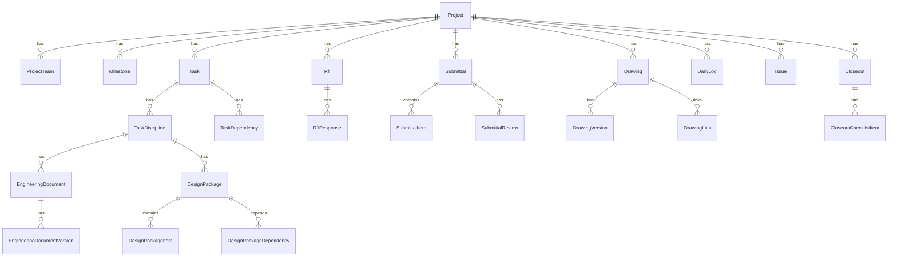

# Project Management Module - Full Implementation Guide

This document describes the **complete Project Management (PM) implementation** in the Construction ERP: backend architecture, API surface, database models, frontend routes, UI layout, and feature maturity.

Paths are relative to the monorepo root unless noted.

---

## Table of Contents

1. [Overview](#1-overview)
2. [Architecture](#2-architecture)
3. [Database Models](#3-database-models)
4. [Backend API Reference](#4-backend-api-reference)
5. [Feature Implementation Status](#5-feature-implementation-status)
6. [Frontend Architecture](#6-frontend-architecture)
7. [UI Layout & Visual Design](#7-ui-layout--visual-design)
8. [Navigation Map](#8-navigation-map)
9. [Screen-by-Screen UI Guide](#9-screen-by-screen-ui-guide)
10. [Data Fetching & State](#10-data-fetching--state)
11. [Permissions & Role Lens](#11-permissions--role-lens)
12. [Related Documentation](#12-related-documentation)

---

## 1. Overview

### Purpose

The Project Management module is the operational core for construction projects after award. It supports:

- **Portfolio management** - register, filter, and track projects company-wide
- **Programme / scheduling** - milestones, tasks, dependencies, Gantt, calendar
- **EPC engineering workflow** - disciplines, engineering documents (EDVs), design packages, multi-tier review, submittals
- **Site operations** - RFIs, issues, daily logs, meetings, correspondence, risks, punch list
- **Document control** - drawings register, project document folders (Core Documents module)
- **Project closeout** - handover checklist and status workflow

All data is **company-scoped** (`company_id` from JWT). Project sub-resources are **project-scoped** (`projectId` in the URL).

### Module Location

| Layer | Path |
|-------|------|
| Backend module | `backend/src/modules/project-management/` |
| Prisma models | `backend/prisma/schema.prisma` (lines ~908–2336) |
| Frontend pages | `frontend/app/(dashboard)/projects/` |
| Frontend components | `frontend/components/modules/projects/` (~74 files) |
| Query hooks | `frontend/lib/query/` (`projects.ts`, `schedule.ts`, `rfis.ts`, etc.) |
| Types | `frontend/lib/api/project-management.types.ts`, `frontend/lib/api/epc.types.ts` |
| Navigation config | `frontend/lib/navigation/project-workspace-nav.ts` |

There is **one** NestJS module for all PM concerns - no separate `project-setup` module.

---

## 2. Architecture

### 2.1 Backend Structure

```
backend/src/modules/project-management/
├── domain/                    # State machines, permission evaluator, validators (36 files)
├── application/
│   ├── dtos/
│   │   ├── pm.dtos.ts         # Classic PM DTOs
│   │   └── engineering-document.dtos.ts  # EPC workflow DTOs
│   ├── services/              # 44 application services
│   ├── processors/            # BullMQ: workflow-committed, workflow-sla
│   ├── constants/
│   └── utils/
├── infrastructure/
│   ├── repositories/          # EPC workflow (5 Prisma adapters)
│   └── mappers/
└── presentation/
    ├── controllers/           # 19 REST controllers
    └── cron/                  # review-sla, projection-reconciliation
```

**Architecture notes:**

- **No CQRS** - unlike `auth`, PM uses application services calling Prisma directly (classic PM) or infrastructure repositories (EPC workflow).
- **Rich domain layer** for EPC: EDV state machine, workflow kernel, permission evaluator, conflict guards.
- **Async processing** via BullMQ for workflow commits and SLA dispatch (Redis-gated).
- **Global API prefix:** `/api` (configurable via `API_PREFIX`).
- **Auth on every endpoint:** `PermissionsGuard` + `@RequirePermission(module, action)`.

### 2.2 Frontend Structure

```
frontend/
├── app/(dashboard)/
│   ├── projects/page.tsx                          # Portfolio list
│   ├── kanban-board/page.tsx                      # Portfolio kanban
│   ├── review-inbox/page.tsx                      # Company review queue
│   ├── my-comments/page.tsx                       # Designer comment responses
│   ├── design-packages/[packageId]/review/page.tsx # Full-screen review mode
│   └── projects/[projectId]/
│       ├── layout.tsx                             # RoleLensProvider + ProjectShell
│       ├── page.tsx                               # Dashboard
│       ├── overview/status|workload/
│       ├── schedule/
│       ├── disciplines/[taskDisciplineId]/packages/[packageId]/
│       ├── engineering-documents/[edId]/
│       ├── deliverables/, submittals/, rfis/, issues/, ...
│       └── closeout/
└── components/modules/projects/
    ├── ProjectShell.tsx, ProjectDashboard.tsx, ProjectsPageContent.tsx
    ├── schedule/, disciplines/, design-packages/, engineering/
    ├── workspaces/, review/, submittals/, rfis/, issues/
    ├── daily-logs/, drawings/, meetings/, correspondence/
    ├── risks/, punch-items/, closeout/
    └── ...
```

**Pattern:** Thin Next.js page → fat `*PageContent` client component → TanStack Query hooks → Axios → REST API.

---

## 3. Database Models

### 3.1 Core Project & Schedule

| Model | Purpose |
|-------|---------|
| `Project` | Project master - code, name, status, type, dates, budget, location, PM |
| `ProjectTeam` | Team membership with role-on-project |
| `Milestone` | Schedule milestones |
| `Task` | Tasks with hierarchy, progress, EPC metadata |
| `TaskDiscipline` | Per-task engineering disciplines |
| `TaskDependency` | Predecessor/successor links |
| `TaskDisciplineReview` | Tiered discipline reviews |

### 3.2 EPC / Engineering Workflow

| Model | Purpose |
|-------|---------|
| `EngineeringDocument` | ED registry per discipline |
| `EngineeringDocumentVersion` (EDV) | Versioned docs linked to `DocumentVersion` |
| `DesignPackage` | Grouped EDVs for review/release |
| `DesignPackageItem` | Package ↔ EDV membership |
| `DesignPackageDependency` | Inter-package dependencies |
| `WorkflowEventLog` | Immutable workflow audit trail |
| `ReviewSession` | Package review sessions |
| `ReviewContextSnapshot` | Point-in-time review context |
| `ReviewComment` | Threaded review comments |
| `Deliverable` | Deliverable tracking (schema only - no dedicated API yet) |
| `ExternalReviewTrigger` | External review triggers |
| `SubmittalItem` | Submittal line items (EDV/package refs) |
| `ProjectChangeRequest` | Change requests from RFI/external review (internal service) |

### 3.3 Classic PM Entities

| Model | Purpose |
|-------|---------|
| `Rfi`, `RfiResponse` | RFIs and responses |
| `Submittal`, `SubmittalReview` | Submittal packages and reviews |
| `Drawing`, `DrawingVersion`, `DrawingLink` | Drawing register |
| `DailyLog` + `DailyLogWorkforce`, `DailyLogEquipment`, `DailyLogVisitor`, `DailyLogIncident` | Site daily logs |
| `Meeting`, `MeetingAgendaItem`, `MeetingAttendee`, `ActionItem` | Meetings |
| `Correspondence` | Formal correspondence log |
| `Risk` | Risk register |
| `Issue` | Issues / defects |
| `PunchItem` | Punch list |
| `Closeout`, `CloseoutChecklistItem`, `Warranty` | Project closeout |

### 3.4 Key Enums

`ProjectStatus`, `TaskStatus`, `RfiStatus`, `SubmittalStatus`, `EdvStatus`, `DeliverableStatus`, `IssueStatus`, `PunchItemStatus`, `RiskStatus`, `MeetingType`, `CloseoutStatus`, `ProjectChangeRequestStatus`

---

## 4. Backend API Reference

### 4.1 Controllers (19)

| Controller | Base Path | Service(s) |
|------------|-----------|------------|
| `projects.controller` | `/api/projects` | `ProjectsService`, `ProjectScopeService` |
| `schedule.controller` | `/api/projects/:projectId/schedule` | `ScheduleService` |
| `rfis.controller` | `/api/projects/:projectId/rfis` | `RfisService` |
| `issues.controller` | `/api/projects/:projectId/issues` | `IssuesService` |
| `submittals.controller` | `/api/projects/:projectId/submittals` | `SubmittalsService`, `SubmittalWorkflowService` |
| `drawings.controller` | `/api/projects/:projectId/drawings` | `DrawingsService` |
| `engineering-documents.controller` | `.../task-disciplines/:taskDisciplineId/engineering-documents` | `EngineeringDocumentsService` |
| `design-packages.controller` | `.../task-disciplines/:taskDisciplineId/design-packages` | `DesignPackagesService`, `ReviewWorkflowService` |
| `engineering-batch.controller` | `/api/projects/:projectId` | `ReviewBatchService`, `DecisionTraceService`, `RevisionOrchestratorService` |
| `review-comments.controller` | `/api/review-comments` | `ReviewCommentsService` |
| `review-batch.controller` | `/api/review` | `ReviewBatchService` |
| `epc-workspace.controller` | `/api` (root-level) | `EpcWorkspaceService` |
| `workflow-events.controller` | `/api/workflow-events` | `WorkflowCorrectionService` |
| `daily-logs.controller` | `/api/projects/:projectId/daily-logs` | `DailyLogsService` |
| `meetings.controller` | `/api/projects/:projectId/meetings` | `MeetingsService` |
| `correspondence.controller` | `/api/projects/:projectId/correspondence` | `CorrespondenceService` |
| `risks.controller` | `/api/projects/:projectId/risks` | `RisksService` |
| `punch-items.controller` | `/api/projects/:projectId/punch-items` | `PunchItemsService` |
| `closeout.controller` | `/api/projects/:projectId/closeout` | `CloseoutService` |

### 4.2 Endpoint Summary (~120 endpoints)

#### Projects
```
GET/POST           /api/projects
GET/PATCH/DELETE   /api/projects/:id
GET                /api/projects/:projectId/dashboard
GET/PUT            /api/projects/:projectId/team
```

#### Schedule
```
GET/POST/PATCH/DELETE  /api/projects/:projectId/schedule/milestones[/:id]
GET/POST/PATCH/DELETE  /api/projects/:projectId/schedule/tasks[/:id]
GET                    /api/projects/:projectId/schedule/disciplines
GET                    /api/projects/:projectId/schedule/disciplines/:disciplineId
GET/POST/PATCH/DELETE  /api/projects/:projectId/schedule/tasks/:taskId/disciplines[/:disciplineId]
GET/POST/PATCH/DELETE  /api/projects/:projectId/schedule/task-dependencies[/:id]
```

#### RFIs
```
GET/POST/PATCH/DELETE  /api/projects/:projectId/rfis[/:rfiId]
GET/POST               /api/projects/:projectId/rfis/:rfiId/responses
```

#### Submittals
```
GET/POST/PATCH/DELETE  /api/projects/:projectId/submittals[/:id]
POST                   /api/projects/:projectId/submittals/design-package
POST                   /api/projects/:projectId/submittals/:id/issue
POST                   /api/projects/:projectId/submittals/:id/items
POST                   /api/projects/:projectId/submittals/batch-issue
POST                   /api/projects/:projectId/submittals/batch-add-items
GET/POST               /api/projects/:projectId/submittals/:id/reviews
```

#### Drawings
```
GET/POST/PATCH/DELETE  /api/projects/:projectId/drawings[/:id]
GET                    /api/projects/:projectId/drawings/:id/versions
GET/POST/DELETE        /api/projects/:projectId/drawings/:id/links[/:linkId]
```

#### Engineering Documents (EDVs)
```
GET/POST/PATCH/DELETE  .../engineering-documents[/:id]
GET                    .../engineering-documents/upload-folder
POST                   .../engineering-documents/register
POST/PATCH             .../engineering-documents/:id/versions[/:versionId]
POST                   .../engineering-documents/:id/versions/:versionId/transition
GET                    .../engineering-documents/:id/versions/:versionId/events
POST                   /api/projects/:projectId/engineering-documents/batch-lock
GET                    /api/projects/:projectId/engineering-documents/:id/decision-trace
POST                   /api/projects/:projectId/engineering-documents/:id/trigger-revision
```

#### Design Packages
```
GET/POST/PATCH/DELETE  .../design-packages[/:packageId]
POST/DELETE            .../design-packages/:packageId/items[/:itemId]
GET/POST/DELETE        .../design-packages/:packageId/dependencies[/:dependencyId]
POST                   .../design-packages/:packageId/lock-edvs
POST                   .../design-packages/:packageId/batch-approve
POST                   .../design-packages/:packageId/batch-return
POST                   .../design-packages/:packageId/submit-for-review
POST                   .../design-packages/:packageId/review-sessions/:reviewSessionId/approve
POST                   .../design-packages/:packageId/return-for-rework
```

#### Review (company-wide)
```
GET/POST/PATCH/DELETE  /api/review-comments[/:commentId]
PATCH                   /api/review-comments/:commentId/status
POST                    /api/review-comments/:commentId/verify
POST                    /api/review/batch-approve
POST                    /api/review/batch-return
GET                     /api/review-inbox
GET                     /api/my-comments
```

#### EPC Workspace
```
GET  /api/projects/:projectId/status-board
GET  /api/projects/:projectId/workload
GET  /api/design-packages/:designPackageId/review-mode
GET  /api/engineering-documents/:engineeringDocumentId/version-history
POST /api/workflow-events/:eventId/correct
```

#### Site Operations
```
GET/POST/PATCH/DELETE  /api/projects/:projectId/daily-logs[/:id]
GET/POST/PATCH/DELETE  /api/projects/:projectId/meetings[/:id]
GET/POST/PATCH/DELETE  /api/projects/:projectId/correspondence[/:id]
GET/POST/PATCH/DELETE  /api/projects/:projectId/risks[/:id]
GET/POST/PATCH/DELETE  /api/projects/:projectId/issues[/:issueId]
GET/POST/PATCH/DELETE  /api/projects/:projectId/punch-items[/:id]
```

#### Closeout
```
GET   /api/projects/:projectId/closeout
POST  /api/projects/:projectId/closeout
PATCH /api/projects/:projectId/closeout
PATCH /api/projects/:projectId/closeout/checklist/:itemId
```

### 4.3 DTOs

| File | Contents |
|------|----------|
| `application/dtos/pm.dtos.ts` | Projects, schedule, RFIs, submittals, drawings, daily logs, meetings, correspondence, risks, issues, punch items, closeout |
| `application/dtos/engineering-document.dtos.ts` | EDV register/upload/transition, design packages, review comments, batch operations, workflow events |

---

## 5. Feature Implementation Status

| ERP Feature | Backend | Frontend | Status |
|-------------|---------|----------|--------|
| **Project Setup** (CRUD, team, dashboard) | Full | `/projects`, `/team`, dashboard | ✅ Implemented |
| **Programme / Scheduling** | Full CRUD + disciplines | Gantt, Tasks, Milestones, Calendar tabs | ✅ Implemented |
| **Task Disciplines & EPC** | Full CRUD + projected status | `/disciplines` pages | ✅ Implemented |
| **Engineering Documents (EDV)** | Full lifecycle + workflow kernel | `EngineeringDocumentPanel`, detail page | ✅ Implemented (most mature) |
| **Design Packages** | Full CRUD + review workflow + batch ops | Package builder, detail, review mode | ✅ Implemented (advanced) |
| **Review Inbox / Comments** | Comments, batch approve/return, SLA cron | `/review-inbox`, `/my-comments` | ✅ Implemented |
| **Submittals** | CRUD + issue workflow + design-package submittals | `/submittals` with drawers | ✅ Implemented (advanced) |
| **RFIs** | CRUD + responses | `/rfis` with detail drawer | ✅ Implemented |
| **Drawings** | CRUD + versions + links | `/drawings` | ✅ Implemented (basic version upload) |
| **Daily Site Logs** | Header CRUD; child entities read-only | `/daily-logs` | ⚠️ Partial - no write APIs for workforce/equipment/visitors/incidents |
| **Meetings** | Header CRUD; agenda/attendees read-only | `/meetings` | ⚠️ Partial - no agenda/attendee/action-item APIs |
| **Correspondence** | Full CRUD | `/correspondence` | ✅ Implemented (list-first UI) |
| **Risk Register** | Full CRUD | `/risks` | ✅ Implemented (list-first UI) |
| **Issues & Defects** | Full CRUD | `/issues` | ✅ Implemented |
| **Punch List** | Full CRUD | `/punch-list` | ✅ Implemented (list-first UI) |
| **Project Closeout** | Init + checklist | `/closeout` | ⚠️ Partial - `Warranty` model has no CRUD API |
| **Deliverables** | Schema only | Aggregates design packages | ⚠️ Partial |
| **Project Change Requests** | Internal service only | None | ⚠️ Partial - backend-only |
| **Status Board / Workload** | EPC workspace endpoints | `/overview/status`, `/overview/workload` | ✅ Implemented |
| **Portfolio Kanban** | Project list/kanban | `/kanban-board` | ✅ Implemented |
| **Documents (DMS)** | Separate `documents` module | `/documents` panel | ✅ Integrated |

---

## 6. Frontend Architecture

### 6.1 Layout Hierarchy

```
AppShell (global - navy top nav 48px + dark sidebar 240px)
├── Dashboard, Projects, Review Inbox*, My Comments*, Kanban Board
└── /projects/[projectId]/*
    └── ProjectShell
        ├── Header card (project name, status, dates, budget, location)
        ├── ProjectWorkspaceSidebar (264px, grouped menu, RBAC-filtered)
        └── [page content]
```

`*` = capability-gated in AppShell sidebar

### 6.2 Component Hierarchy

```
ProjectsPageContent
└── ProjectFormDrawer

ProjectShell
├── ProjectWorkspaceSidebar
└── [active page]
    ├── ProjectDashboard → KPICards, ProjectStatusBoard, quick links
    ├── SchedulePageContent → ScheduleKpiBar + Tabs (Gantt|Tasks|Milestones|Calendar)
    ├── DisciplinesPageContent → DisciplineDetailDrawer
    ├── DisciplineDetailPageContent
    │   ├── DesignPackagePanel → DesignPackageBuilder
    │   └── EngineeringDocumentPanel → EdvMetadataForm drawer
    ├── DesignPackageDetailPageContent → items/dependencies tables, review actions
    ├── EngineeringDocumentDetailPageContent → DecisionTraceView, VersionHistoryTimeline
    ├── SubmittalsPageContent → SubmittalDetailDrawer, SubmittalPackageDrawer
    ├── RfisPageContent / IssuesPageContent / DailyLogsPageContent / DrawingsPageContent
    │   └── [shared pattern] DataTable + FormDrawer + DetailDrawer
    ├── ProjectDocumentsPanel → DocumentAttachmentPanel
    ├── ProjectTeamPanel → multi-select + DataTable
    └── CloseoutPageContent → WorkflowStepper + checklist
```

### 6.3 Shared UI Components Used

| Component | Location | Used For |
|-----------|----------|----------|
| `AppShell` | `components/ui/AppShell/` | Global layout |
| `FormLayout` | `components/ui/FormLayout/` | Page title, filters, actions row |
| `DataTable` | `components/ui/DataTable/` | All list screens |
| `StatusBadge` | `components/ui/StatusBadge/` | Project, RFI, issue status pills |
| `EdvStatusBadge` | `components/ui/EdvStatusBadge/` | EDV workflow status |
| `KPICard` | `components/ui/KPICard/` | Dashboard metrics |
| `PageHeader` / `HeaderActions` | `components/ui/PageHeader/` | Breadcrumbs, user menu |
| `ConfirmDialog` | `components/ui/ConfirmDialog/` | Delete/status-change confirmations |
| `PlaceholderPage` | `components/PlaceholderPage` | Empty/error states |

---

## 7. UI Layout & Visual Design

The PM module follows a **Procore-inspired** design system defined in `.cursorrules` and applied via Ant Design `ConfigProvider`.

### 7.1 Color Palette

| Token | Hex | Usage |
|-------|-----|-------|
| Primary orange | `#F47B20` | Primary buttons, active nav, links |
| Orange hover | `#D4610A` | Button hover states |
| Orange light | `#FEF0E6` | Highlight backgrounds |
| Navy (top nav) | `#1B2B4B` | AppShell header bar |
| Dark (sidebar) | `#2C3E50` | Global sidebar background |
| Sidebar hover | `#3D5166` | Sidebar item hover |
| Page background | `#F5F6F7` | Main content area |
| Card background | `#FFFFFF` | Cards, tables, drawers |
| Border | `#E5E7EB` | Card and table borders |
| Text primary | `#1A1A1A` | Headings, body text |
| Text secondary | `#6B7280` | Labels, metadata |

### 7.2 Global Shell (AppShell)

```
┌─────────────────────────────────────────────────────────────────┐
│  NAVY TOP BAR (48px) - logo, page title, user menu, notifications│
├──────────┬──────────────────────────────────────────────────────┤
│  DARK    │  PAGE BACKGROUND (#F5F6F7)                          │
│  SIDEBAR │                                                       │
│  (240px) │  ┌─────────────────────────────────────────────────┐ │
│          │  │  WHITE CARD - page content                       │ │
│  • Dash  │  │                                                   │ │
│  • Proj  │  │  FormLayout header (title + filters + actions)   │ │
│  • Inbox │  │  ─────────────────────────────────────────────  │ │
│  • Comm  │  │  DataTable / tabs / panels                       │ │
│  • Kanban│  │                                                   │ │
│          │  └─────────────────────────────────────────────────┘ │
└──────────┴──────────────────────────────────────────────────────┘
```

### 7.3 Project Workspace Shell (ProjectShell)

When you open a project, the global sidebar stays; content area switches to the **project workspace**:

```
┌─────────────────────────────────────────────────────────────────┐
│  [Global AppShell - unchanged]                                   │
├──────────┬──────────────────────────────────────────────────────┤
│  Global  │  ┌─ PROJECT HEADER CARD (white) ──────────────────┐  │
│  sidebar │  │  Project Name          [Status Badge]           │  │
│          │  │  PRJ-001                                        │  │
│          │  │  Start | Planned Finish | Budget | Location     │  │
│          │  └─────────────────────────────────────────────────┘  │
│          │                                                       │
│          │  ┌─ PROJECT SIDEBAR ─┐  ┌─ MAIN CONTENT ──────────┐  │
│          │  │ Overview          │  │                          │  │
│          │  │  • Dashboard      │  │  Active page renders     │  │
│          │  │  • Status Board   │  │  here (dashboard, table, │  │
│          │  │  • Workload       │  │  Gantt, etc.)            │  │
│          │  │ Engineering       │  │                          │  │
│          │  │  • Schedule       │  │                          │  │
│          │  │  • Disciplines    │  │                          │  │
│          │  │  • Deliverables   │  │                          │  │
│          │  │ Review & Release  │  │                          │  │
│          │  │  • Submittals     │  │                          │  │
│          │  │ Site Operations   │  │                          │  │
│          │  │  • RFIs ...       │  │                          │  │
│          │  │ Project Records   │  │                          │  │
│          │  │  • Documents ...  │  │                          │  │
│          │  └───────────────────┘  └──────────────────────────┘  │
└─────────── (264px sidebar) ─────────────────────────────┘
```

**Mobile:** Project sidebar collapses into a left `Drawer` triggered by a "Menu" button in the header card.

### 7.4 Common Screen Patterns

#### List Screen Pattern (RFIs, Issues, Submittals, etc.)

```
┌─ FormLayout ─────────────────────────────────────────────────────┐
│  RFIs                                    [+ New RFI]  (orange)  │
│  ─────────────────────────────────────────────────────────────── │
│  [Search________]  [Status ▼]                                   │
│  ┌─────────────────────────────────────────────────────────────┐│
│  │ Number │ Title │ Discipline │ Priority │ Status │ Due │ ... ││
│  │ RFI-01 │ ...   │ Structural │ High     │ [Open] │ ... │ 👁  ││
│  └─────────────────────────────────────────────────────────────┘│
│  [< 1 2 3 >]                                                    │
└─────────────────────────────────────────────────────────────────┘
         │
         └── row click / edit → RIGHT DRAWER (480–720px)
             ├── Form fields (create/edit)
             └── Detail tabs (responses, history)
```

#### Schedule Screen

```
┌─ Schedule KPI Bar ──────────────────────────────────────────────┐
│  [Total Tasks: 42] [Completed: 18] [Overdue: 3] [Variance: -5%] │
└─────────────────────────────────────────────────────────────────┘
┌─ Tabs ──────────────────────────────────────────────────────────┐
│  [Gantt] [Tasks] [Milestones] [Calendar]                         │
│  ─────────────────────────────────────────────────────────────── │
│  Gantt: horizontal timeline bars with dependency lines          │
│  Tasks: DataTable with inline progress, TaskFormDrawer on edit  │
│  Milestones: table with date, status, linked tasks              │
│  Calendar: month/year view of task due dates                    │
└─────────────────────────────────────────────────────────────────┘
```

#### Engineering Hierarchy (Discipline → Package → Document)

```
Disciplines list
    └── click row → Discipline Detail
            ├── Design Packages panel (cards/table)
            │       └── click package → Package Detail
            │               ├── Items table (EDVs in package)
            │               ├── Dependencies table
            │               └── Review actions (Submit, Approve, Return)
            └── Engineering Documents panel (table)
                    └── click document → Document Detail
                            ├── Decision trace timeline
                            └── Version history
```

#### Status Badges

Status values render as colored pills via `StatusBadge` / `EdvStatusBadge`:

| Status type | Example values | Visual |
|-------------|----------------|--------|
| Project | Planning, Active, On Hold, Completed | Green / blue / amber / gray pills |
| RFI | Draft, Open, Answered, Closed | Color-coded by workflow state |
| EDV | Draft, In Review, Approved, Issued | EPC-specific color mapping |
| Issue | Open, In Progress, Resolved | Severity-aware colors |

Primary actions use **orange buttons** (`type="primary"`). Destructive actions use red with `ConfirmDialog`.

---

## 8. Navigation Map

### 8.1 Global Routes

| URL | Component | Description |
|-----|-----------|-------------|
| `/projects` | `ProjectsPageContent` | Portfolio list with search, filter, pagination |
| `/kanban-board` | `PortfolioKanbanPageContent` | Drag-and-drop kanban by project status |
| `/review-inbox` | `ReviewInboxPageContent` | Company-wide review queue (capability-gated) |
| `/my-comments` | `MyCommentsPageContent` | Assigned review comments for designers |
| `/design-packages/[id]/review` | `DesignPackageReviewModeClient` | Full-screen package review workspace |

### 8.2 Project Workspace Routes

| URL | Component | Nav Group |
|-----|-----------|-----------|
| `/projects/[id]` | `ProjectDashboard` | Overview |
| `/projects/[id]/overview/status` | `StatusBoardPageContent` | Overview |
| `/projects/[id]/overview/workload` | `WorkloadPageContent` | Overview |
| `/projects/[id]/schedule` | `SchedulePageContent` | Engineering |
| `/projects/[id]/disciplines` | `DisciplinesPageContent` | Engineering |
| `/projects/[id]/disciplines/[taskDisciplineId]` | `DisciplineDetailPageContent` | Engineering |
| `/projects/[id]/disciplines/.../packages/[packageId]` | `DesignPackageDetailPageContent` | Engineering |
| `/projects/[id]/engineering-documents/[edId]` | `EngineeringDocumentDetailPageContent` | Engineering |
| `/projects/[id]/deliverables` | `DeliverablesPageContent` | Engineering |
| `/projects/[id]/submittals` | `SubmittalsPageContent` | Review & Release |
| `/projects/[id]/rfis` | `RfisPageContent` | Site Operations |
| `/projects/[id]/issues` | `IssuesPageContent` | Site Operations |
| `/projects/[id]/daily-logs` | `DailyLogsPageContent` | Site Operations |
| `/projects/[id]/meetings` | `MeetingsPageContent` | Site Operations |
| `/projects/[id]/correspondence` | `CorrespondencePageContent` | Site Operations |
| `/projects/[id]/risks` | `RisksPageContent` | Site Operations |
| `/projects/[id]/punch-list` | `PunchItemsPageContent` | Site Operations |
| `/projects/[id]/documents` | `ProjectDocumentsPanel` | Project Records |
| `/projects/[id]/drawings` | `DrawingsPageContent` | Project Records |
| `/projects/[id]/team` | `ProjectTeamPanel` | Project Records |
| `/projects/[id]/closeout` | `CloseoutPageContent` | Project Records |

### 8.3 Navigation Tree

```
AppShell
├── Projects (/projects)
│   └── [Click project code]
│       └── ProjectShell
│           ├── Overview
│           │   ├── Dashboard
│           │   ├── Status Board
│           │   └── Workload
│           ├── Engineering
│           │   ├── Schedule → Gantt | Tasks | Milestones | Calendar
│           │   ├── Disciplines → Detail → Packages / EDVs
│           │   └── Deliverables
│           ├── Review & Release
│           │   └── Submittals
│           ├── Site Operations
│           │   ├── RFIs → Detail drawer + responses
│           │   ├── Issues → Detail drawer
│           │   ├── Daily Logs → Detail drawer
│           │   ├── Meetings
│           │   ├── Correspondence
│           │   ├── Risks
│           │   └── Punch List
│           └── Project Records
│               ├── Documents
│               ├── Drawings
│               ├── Team
│               └── Closeout
├── Review Inbox (/review-inbox)
├── My Comments (/my-comments)
└── Kanban Board (/kanban-board)
    └── [Drag card] → status change confirmation
```

Sidebar items are **filtered by RBAC** via `usePmCapabilities()` and `useEpcCapabilities()`. Items the user cannot view are hidden.

---

## 9. Screen-by-Screen UI Guide

### 9.1 Portfolio - Projects List (`/projects`)

**What you see:**
- White card with page title "Projects"
- Search input and status filter dropdown
- Orange **"+ New Project"** button (top right)
- Paginated table: Code (link), Name, Type, Status badge, Planned Finish, Budget, Location
- Row edit icon opens drawer

**Interactions:**
- Click project code → navigate to project dashboard
- Create/edit → right-side `ProjectFormDrawer` with Ant Design Form fields

---

### 9.2 Portfolio - Kanban Board (`/kanban-board`)

**What you see:**
- Horizontal columns grouped by project status (Planning, Active, On Hold, Completed, etc.)
- Project cards showing name, code, dates
- Search bar to filter cards

**Interactions:**
- Drag card between columns → `ConfirmDialog` → updates project status via API
- Click card → navigate to project dashboard

---

### 9.3 Project Dashboard (`/projects/[id]`)

**What you see:**
- Project header card (name, status badge, code, start/finish/budget/location)
- 4 KPI cards: Open RFIs, Overdue RFIs, Open Issues, Open Punch Items
- Compact EPC status board snapshot (active reviews, SLA overdue, open comments)
- Schedule progress bar (planned vs actual vs variance)
- Quick-link cards to Disciplines, Status Board, Submittals, Schedule

---

### 9.4 Status Board (`/projects/[id]/overview/status`)

**What you see:**
- 4 KPI cards: Active reviews, SLA overdue, Open comments, Pending submittals
- Breakdown cards showing design packages and disciplines grouped by projected status
- Color-coded status counts

---

### 9.5 Workload (`/projects/[id]/overview/workload`)

**What you see:**
- Sortable table of reviewers
- Columns: Reviewer name, Assigned sessions, Open comments, SLA overdue count

---

### 9.6 Schedule (`/projects/[id]/schedule`)

**What you see:**
- KPI bar: total tasks, completed, overdue, schedule variance
- Tab bar: **Gantt | Tasks | Milestones | Calendar**
- **Gantt tab:** Timeline visualization with task bars and dependency arrows
- **Tasks tab:** DataTable with create/edit via `TaskFormDrawer`
- **Milestones tab:** Milestone table with CRUD
- **Calendar tab:** Month/year calendar with task due dates

---

### 9.7 Disciplines & Packages (`/projects/[id]/disciplines`)

**What you see:**
- Searchable table: Discipline name, linked task, package count, projected status badge
- Create discipline button → `DisciplineDetailDrawer`

**Discipline Detail page:**
- Breadcrumb: Disciplines → [Discipline Name]
- `Descriptions` block with discipline metadata
- **Design Packages** panel - package cards/table with status, item count
- **Engineering Documents** panel - EDV table with document number, title, type, latest version status

**Package Detail page:**
- Items table (EDVs in package)
- Dependencies table (inter-package links)
- Review action buttons: Submit for Review, Lock EDVs, Batch Approve, Return for Rework

**Engineering Document Detail page:**
- Decision trace view (workflow event timeline)
- Version history timeline with status transitions

---

### 9.8 Deliverables (`/projects/[id]/deliverables`)

**What you see:**
- Flat table of all design packages across all disciplines
- Links to individual package detail pages

---

### 9.9 Submittals (`/projects/[id]/submittals`)

**What you see:**
- Paginated table: Number, Title, Category, Revision, Status badge, Due date, Contractor
- Status filter dropdown
- **"+ New Submittal"** and **"Design Package Submittal"** buttons

**Drawers:**
- `SubmittalFormDrawer` - create/edit
- `SubmittalDetailDrawer` - detail with review history
- `SubmittalPackageDrawer` - issue submittal from design package

---

### 9.10 RFIs (`/projects/[id]/rfis`)

**What you see:**
- Table: Number, Title, Discipline, Priority, Status, Assignee, Due date
- Create via `RfiFormDrawer`, detail via `RfiDetailDrawer` with responses thread

---

### 9.11 Issues (`/projects/[id]/issues`)

**What you see:**
- Table: Number, Title, Severity, Status, Assignee, Due date
- Full CRUD via form and detail drawers

---

### 9.12 Daily Logs (`/projects/[id]/daily-logs`)

**What you see:**
- Table: Date, Shift, Weather, Crew count, Author
- Create via `DailyLogFormDrawer`, detail via `DailyLogDetailDrawer`

---

### 9.13 Drawings (`/projects/[id]/drawings`)

**What you see:**
- Table: Number, Title, Discipline, Revision, Status
- Create via `DrawingFormDrawer`, detail with versions and links

---

### 9.14 Meetings, Correspondence, Risks, Punch List

**What you see:**
- List-first screens with `DataTable` and pagination
- Meetings/Correspondence/Risks/Punch List are primarily **read-only tables** today (backend CRUD exists; create/edit UI not yet wired for all)

---

### 9.15 Documents (`/projects/[id]/documents`)

**What you see:**
- Resolves the project's document folder from Core Documents module
- `DocumentAttachmentPanel` - file browser, upload, folder navigation

---

### 9.16 Team (`/projects/[id]/team`)

**What you see:**
- Multi-select user picker
- Member table: Name, Email, Role on project
- Save button to persist team changes

---

### 9.17 Closeout (`/projects/[id]/closeout`)

**What you see:**
- `WorkflowStepper` showing closeout phase
- Summary `Descriptions` block
- Interactive checklist with checkbox toggles per item

---

### 9.18 Review Inbox (`/review-inbox`)

**What you see:**
- Company-wide table of pending review sessions
- Tier filter dropdown
- Columns: Package, Project, Discipline, Tier, SLA status, Assigned date
- Click row → navigate to package review or review mode

---

### 9.19 My Comments (`/my-comments`)

**What you see:**
- Table of review comments assigned to the current user
- Detail drawer with comment thread
- `RevisionWorkspace` modal for responding to comments

---

## 10. Data Fetching & State

### 10.1 Stack

| Concern | Technology |
|---------|------------|
| Server state | TanStack Query v5 |
| HTTP client | Axios (`frontend/lib/api/client.ts`) |
| Client state | Zustand (`project-context.store`, `auth.store`) |
| Form state | Ant Design Form |

### 10.2 Query Hook Modules

| File | Key Hooks |
|------|-----------|
| `lib/query/projects.ts` | `useProjects`, `useProject`, `useProjectDashboardStats`, `useProjectTeam`, CRUD mutations |
| `lib/query/schedule.ts` | `useAllTasks`, `useMilestones`, `useTaskDependencies`, task/discipline CRUD |
| `lib/query/disciplines.ts` | `useProjectDisciplines`, `useProjectDiscipline` |
| `lib/query/design-packages.ts` | `useDesignPackages`, review workflow mutations |
| `lib/query/engineering-documents.ts` | `useEngineeringDocuments`, register, batch lock/approve |
| `lib/query/epc-workspace.ts` | `useReviewInbox`, `useMyComments`, `useProjectStatusBoard`, `useProjectWorkload` |
| `lib/query/rfis.ts` | `useRfis`, `useRfi`, responses |
| `lib/query/submittals.ts` | Submittal CRUD + issue workflow |
| `lib/query/issues.ts` | Issue CRUD |
| `lib/query/daily-logs.ts` | Daily log list + create |
| `lib/query/drawings.ts` | Drawing list + create |
| `lib/query/closeout.ts` | `useCloseout`, checklist mutations (auto-init on 404) |
| `lib/query/documents.ts` | Project folder resolution + upload |

### 10.3 Common Patterns

1. **`enabled` flags** - queries gated on auth hydration, capabilities, or active tab
2. **`retry: false`** on PM reads - 404 treated as "API not connected" with graceful `Alert`
3. **Mutations invalidate** related query keys on success
4. **`useAllProjects` / `useAllTasks`** - walk paginated API (page size 100) for portfolio/Gantt
5. **Polling** - discipline projection status uses `refetchInterval` when `projectionPending`
6. **Path helper** - `projectPath(projectId, resource)` in `lib/query/pm-query-utils.ts`

### 10.4 API Response Envelope

All responses follow:

```json
{ "success": true, "data": T, "meta": { "total", "page", "limit", "pages" } }
```

List endpoints support: `?page=1&limit=20&sortBy=createdAt&sortOrder=desc`

---

## 11. Permissions & Role Lens

### 11.1 Backend

Every controller method uses:

```typescript
@UseGuards(PermissionsGuard)
@RequirePermission('rfis', 'view')  // module + action
```

Actions: `view`, `create`, `edit`, `delete` per PM module key.

### 11.2 Frontend Capability Hooks

| Hook | Purpose |
|------|---------|
| `usePmCapabilities()` | Per-module `canView/canCreate/canEdit/canDelete` |
| `useEpcCapabilities()` | Engineering surface, review inbox, my comments |
| `useCanViewReviewInbox()` | AppShell nav visibility |
| `useCanViewMyComments()` | AppShell nav visibility |

### 11.3 Role Lens (`RoleLensProvider`)

Wraps the project layout. Derives engineering/review/submittal permissions from PM + EPC capabilities. Used by:

- `ProjectWorkspaceSidebar` - hides nav items (including engineering surfaces when the user has no assigned disciplines and lacks bypass)
- `EngineeringDocumentPanel` - gates register/upload actions
- `DesignPackagePanel` - gates review workflow buttons
- `SubmittalsPageContent` - gates design package submittal creation

**Discipline scoping (EPC responsibility workflow):**

- Review tier chain: `DISCIPLINE_OWNER → REVIEWER → DISCIPLINE_LEAD → DEPT_CHIEF` (Institute Chief removed)
- `TaskDiscipline.ownerUserId` assigns the Discipline Owner per discipline
- Non-bypass users only see projects/disciplines where they are assigned (designer, owner, reviewer, lead, or chief)
- Bypass roles: System Administrator, Managing Director, Project Manager
- `disciplineScopeBypass` is exposed on EPC capabilities and consumed by `RoleLensProvider`
- RFIs/Issues support optional `taskDisciplineId` with auto-created attachment folders (`FolderContextType.RFI` / `ISSUE`)
- Submittals support `submittalPurpose` + `preparedByRole` (Discipline Lead single-discipline vs Deputy Chief multi-discipline)

### 11.4 PM Module Keys

`projects`, `schedule`, `rfis`, `submittals`, `drawings`, `dailyLogs`, `meetings`, `correspondence`, `risks`, `issues`, `punchItems`, `closeout`

---

## 12. Related Documentation

| Document | Path | Contents |
|----------|------|----------|
| EPC Operating Model | `docs/epc-operating-model.md` | EPC workflow concepts and roles |
| EPC V1 Contracts | `docs/epc-v1-implementation-contracts.md` | API contracts for engineering workflow |
| Engineering Document Metadata | `docs/engineering-document-metadata.md` | EDV metadata schema |
| PM Study Guide (legacy) | `PROJECT_MANAGEMENT_STUDY_GUIDE.md` | Developer walkthrough (classic PM only - predates EPC) |
| Backend Implementation | `backend/BACKEND_IMPLEMENTATION.md` | General backend patterns |

---

## Appendix A - Entity Relationship (Simplified)



---

## Appendix B - File Index (Key Files)

### Backend
- `backend/src/modules/project-management/project-management.module.ts`
- `backend/src/modules/project-management/application/dtos/pm.dtos.ts`
- `backend/src/modules/project-management/application/dtos/engineering-document.dtos.ts`
- `backend/src/modules/project-management/presentation/controllers/*.controller.ts` (19 files)

### Frontend - Pages
- `frontend/app/(dashboard)/projects/page.tsx`
- `frontend/app/(dashboard)/projects/[projectId]/layout.tsx`
- `frontend/app/(dashboard)/projects/[projectId]/*/page.tsx` (23 routes)

### Frontend - Components
- `frontend/components/modules/projects/ProjectShell.tsx`
- `frontend/components/modules/projects/ProjectDashboard.tsx`
- `frontend/components/modules/projects/ProjectsPageContent.tsx`
- `frontend/components/modules/projects/ProjectWorkspaceSidebar.tsx`
- `frontend/components/modules/projects/engineering/EngineeringDocumentPanel.tsx`
- `frontend/components/modules/projects/schedule/SchedulePageContent.tsx`
- `frontend/components/modules/projects/schedule/ScheduleGantt.tsx`

### Frontend - Config & Hooks
- `frontend/lib/navigation/project-workspace-nav.ts`
- `frontend/lib/api/project-management.types.ts`
- `frontend/lib/api/epc.types.ts`
- `frontend/hooks/use-pm-capabilities.ts`

---

*Last updated: June 2026 - reflects EPC engineering workflow, 19 controllers, 23 project routes, and capability-gated navigation.*
